# Moral hazard: information, incentives, and the design of insurance

Scott Nelson  
Data Engineer  

November 2026

*Draft for review. Not a published paper, and not a live web page. No code is offered here. The aim is a complete conceptual presentation, with the pieces overlaid rather than siloed.*

## Abstract

Moral hazard is the name economics gives to a precise information problem. A contract transfers risk, or ties pay to an outcome, and an unobserved action taken by one party shifts the distribution of that outcome. The first-best allocation, which would be available if the action could be contracted on directly, is then generally unattainable. Residual risk must be left with the acting party in order to preserve incentives, and that residual risk is the cost of the information constraint.

This article treats that constraint as a single grammar. The hidden-action principal-agent model, the design of insurance (deductibles, coinsurance, experience rating, and monitoring), the value of information, and the more recent proposals for transparent and Bitcoin-backed insurance are the same problem viewed from different angles. A signal is valuable in a contract when it is informative about the hidden action, which is Holmström's informativeness principle restated as a value-of-information claim. Public information can also destroy risk sharing before it starts, a possibility associated with Hirshleifer (1971). Parametric and on-chain designs do not repeal the constraint. They change the event that is contractible. The usual price of that change is basis risk, and a new hidden action can appear at the oracle that reports the trigger.

A Bayesian network, or an influence diagram, makes the overlay visible. Moral hazard and adverse selection are distinct stories about which edges are present, and they imply different conditional independencies. Those independencies are why random assignment of coverage, as in the RAND Health Insurance Experiment, identifies a utilization response, and why a raw correlation between coverage and claims cannot, by itself, separate hidden action from hidden type. The article closes with systemic cases and with the ethics of the term, including the objection that "moral hazard" moralizes a rational response to prices. Several normative views are set out without being reduced to one.

**Keywords.** Moral hazard; principal-agent; informativeness principle; adverse selection; value of information; Hirshleifer effect; probabilistic graphical models; parametric insurance; basis risk.

## 1. Introduction: one constraint, many rooms

Insurance exists because people are willing to pay to move a risk off their own books. A risk-averse person prefers a sure loss of size equal to the expected claim, or even a little more, to an unsmoothed gamble. That is the welfare case for insurance, and it is the reason a competitive market can exist at a loaded premium.

The same contract changes the problem it was written to solve. Once the loss is no longer fully the insured's, the insured's reason to prevent it, or to limit its size, is weaker. If that change in behavior cannot be contracted on directly, because the relevant action is hidden, the insurer cannot charge the first-best price and also keep the first-best action. Something has to give. Either the insured retains a share of the loss, or someone spends resources to observe the action, or the contract is written on a different event that is easier to see.

That is moral hazard in the economic sense. It is not a diagnosis of bad character. It is a statement about information. The same statement appears in the relationship between a firm and a worker whose effort is not watched, in deposit insurance, in the design of unemployment benefits, and in any proposal to put insurance on a public ledger. The rooms look different. The constraint does not.

Four ideas organize what follows, and they will be reused rather than replaced as the setting changes.

**Contractibility.** A contract can condition only on events that can be observed and verified, or at least on events the parties are willing to treat as if they were. Hidden actions are, by definition, not among those events.

**Incentives as residual risk.** If the action cannot be contracted on, the outcome that the action influences must remain, in part, the actor's problem. Deductibles, coinsurance, experience rating, performance pay, and uninsured layers are different names for that residue.

**The value of a signal.** An additional observation is worth writing into the contract only if it carries information about the hidden action that the existing observations do not already contain (Holmström 1979). In a single-person decision problem, more information cannot hurt, and the most it can be worth is the expected value of perfect information (Howard 1966). In a market that exists to share risk, early public information can hurt, because it arrives before the sharing has taken place (Hirshleifer 1971).

**A change of contractible event is not a repeal of the constraint.** A parametric trigger, a telematic feed, or an on-chain oracle does not eliminate hidden action. It substitutes a new observable for the original loss. The substitution has a price, usually basis risk, and it can create a new hidden action at the point where the new observable is produced.

The article is a standalone conceptual presentation. It does not depend on other pages, and it does not offer software. Numerical examples are labeled as illustrative. They are computed from stated assumptions, and they are not estimates from data. Empirical claims are taken from named papers, with the limits of those papers attached. A handful of classic articles have no original journal DOI in current records; those entries are cited by volume and pages, with a stable link, and are marked in the reference list.

## 2. Foundations

### 2.1 A definition

**Moral hazard** is a hidden-action problem in a contractual relationship. One party, the agent, takes an action that is not observed by the other party, the principal. The action shifts the probability distribution of an outcome that both care about. The contract can condition on the outcome, and on any other contractible signals, but not on the action itself.

Two timing remarks keep the definition from drifting.

First, the action may occur after the contract is signed, as with care taken once insurance is in force, or it may be taken during the relationship and remain unobserved at the time of settlement. What matters is that the contract cannot be written directly on the action.

Second, the word "hazard" in nineteenth-century insurance usage referred to a risk, and "moral" marked a risk that arose from character or temptation rather than from a physical cause (Baker 1996). The economic definition used here does not require a moral failing. It requires an unobserved action with a social consequence the actor does not fully bear.

The neighboring problem is **adverse selection**, or hidden information about a characteristic that already exists when the contract is chosen, such as a person's risk type. Hidden action and hidden information can be present at the same time. They are not the same constraint, they have different remedies, and they have different implications for what should be independent of what in the data. Section 2.4 gives the family of problems in one place. Section 6 shows the distinction as a difference in a graph.

### 2.2 Arrow, Pauly, and the 1968 exchange

Kenneth Arrow's "Uncertainty and the Welfare Economics of Medical Care" (1963) compared the medical-care industry with the competitive welfare benchmark and traced many of its special features to uncertainty, both in the incidence of illness and in the efficacy of treatment. He argued that the welfare case for insurance is strong, and that the absence of some insurance markets is a form of market failure. The paper is the origin of the modern economic discussion of health insurance, even though the later name "moral hazard" is worked out more fully in the 1968 exchange.

Mark Pauly's comment (1968) is the hinge. If the demand for medical care is price-elastic, then insurance that lowers the out-of-pocket price will raise use. Complete coverage is not generally optimal once that response is admitted. The fact that some insurance markets have failed to appear is not, by itself, evidence that government should supply the missing cover. And the response of seeking more medical care with insurance than in its absence is, he wrote, "a result not of moral perfidy, but of rational economic behavior" (Pauly 1968, 535).

Arrow's further comment (1968) accepted the incentive point in so many words. The optimality of complete insurance "is no longer valid when the method of insurance influences the demand for the services provided by the insurance policy." He likened the effect to an excise tax. He also argued that Pauly's exclusive emphasis on market incentives overlooked professional and social norms, and self-imposed constraints, that can limit the response. The 1968 exchange therefore leaves two live claims, not one: that incentives in the contract matter, and that institutions other than prices can also shape the action.

Those two claims should be kept in view together. A model that ignores prices will miss Pauly's point. A model that admits only prices will miss Arrow's. Section 9 returns to the tension when it takes up ethics.

### 2.3 Ex ante and ex post

The hidden action can sit on either side of the loss.

**Ex ante moral hazard** is a change in prevention, or in other actions taken before a loss, that shifts the probability of the loss, or the distribution of its size. Ehrlich and Becker (1972) separate three instruments: market insurance, self-insurance (reducing the size of a loss, for example by savings or by sprinklers that limit fire damage), and self-protection (reducing the probability of the loss). Market insurance and self-protection can be substitutes. They can also be complements, depending on how the contract is written, which is one reason theory does not deliver a single predicted sign for prevention.

**Ex post moral hazard** is a change in use, or in the size of the loss, after a loss or an illness has occurred. In health insurance this is the rise in medical-care use when the out-of-pocket price falls. It is a movement along a demand curve, exactly as Pauly described.

Zweifel and Manning (2000), in their handbook chapter, report that theory does not unambiguously predict a fall in prevention, and that the empirical evidence on ex ante effects in health care is limited. The case for static ex post moral hazard, an increase in the demand for medical care of a given technology, is stronger, and the evidence is stronger as well. They also flag a possible dynamic form: insurance may bias later choices toward new and usually costlier technology. The evidence they review for that dynamic form is thin.

The distinction matters for design. A deductible that applies only once a claim has occurred is a relatively blunt instrument against ex ante prevention, and a sharper one against ex post use. Experience rating, which ties next year's premium to this year's claims, reaches back toward prevention. Monitoring of the action itself, when it is feasible, reaches the action without waiting for a loss. The same grammar will classify on-chain and parametric designs in Section 7.

### 2.4 A taxonomy of asymmetric information

"Asymmetric information" is a family, not a single problem. Four members of the family are enough for what follows. The rows differ in what is hidden, in when it is hidden, and in who moves first.

| Problem | What is hidden | When | Who moves first | Leading references |
| --- | --- | --- | --- | --- |
| Moral hazard | An action | After the contract, or unobserved at settlement | The contract is already in place; the agent then acts | Pauly (1968); Holmström (1979); Grossman and Hart (1983) |
| Adverse selection | A pre-existing type | Before the contract is chosen | Either party; types sort, or the market unravels | Akerlof (1970); Rothschild and Stiglitz (1976) |
| Signaling | A pre-existing type | Before, or as, the contract is formed | The informed party, who sends a costly signal | Spence (1973) |
| Screening | A pre-existing type | Before the contract is chosen | The uninformed party, who offers a menu of contracts | Rothschild and Stiglitz (1976) |

Akerlof (1970) showed how hidden quality can thin a market: buyers, unable to tell good from bad, offer a price that reflects the average, and the better sellers leave. Rothschild and Stiglitz (1976) studied a competitive insurance market in which risk type is hidden. A pooling contract, in which both types buy the same cover, may be broken by a cream-skimming offer. A separating menu, in which higher-risk agents buy more coverage, may be an equilibrium, or there may be no equilibrium. Spence (1973) studied the other order of moves: the informed party acts first, and a costly signal, education in his model, can reveal type if the cost of the signal differs by type.

Figure 1 puts the three timings in one visual grammar. What the table cannot show is where the dashed information set sits. In panel A the insurer has already offered the contract, and the hidden object is the agent's later prevention; the dashed box marks that action as unobserved, not a later move of the insurer. In panel B, Nature draws a type first, and the insurer offers a menu inside an information set over types. In panel C the informed party sends a signal first, and the dashed line sits at the insurer's reply to a signal that more than one type might have sent.

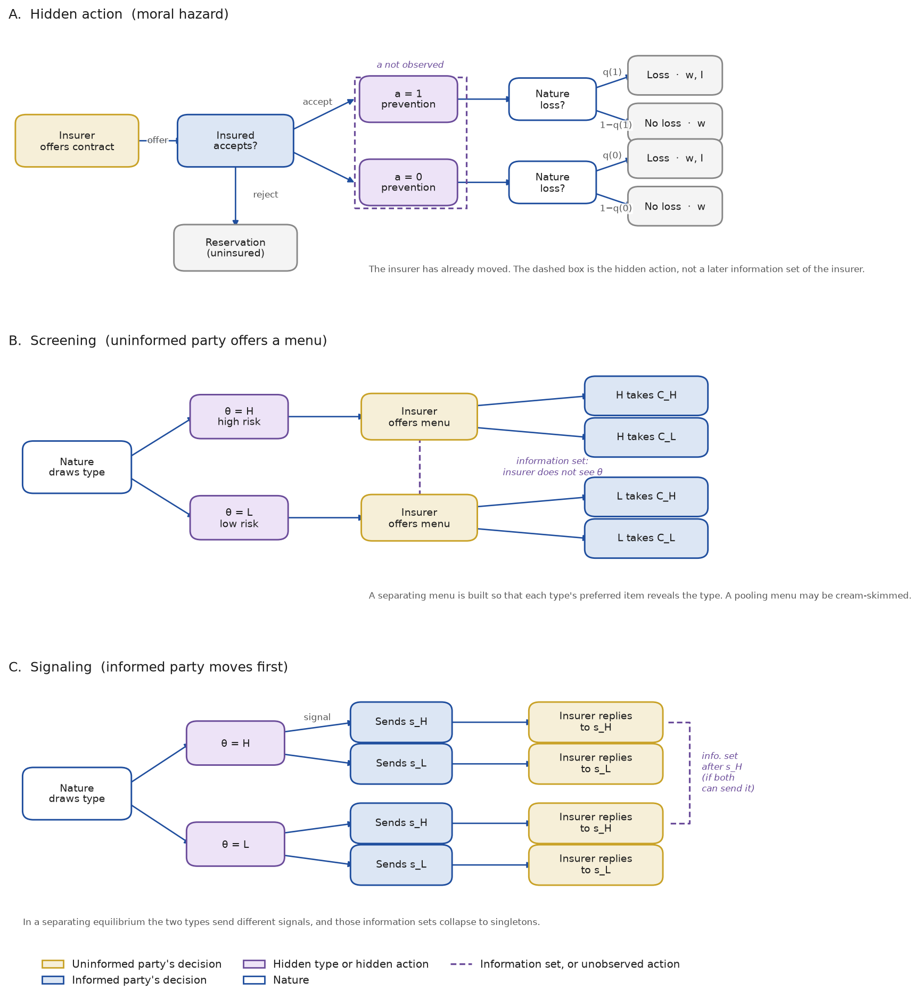

A play of the hidden-action tree, using the illustrative contract of Section 3.7, runs as follows.

1. The insurer offers coinsurance at rate $\alpha \approx 0.625$, at the high-prevention premium $\pi \approx 7.20$.
2. The agent accepts, because expected utility under high prevention, about $9.001$, exceeds the uninsured reservation $8.8$.
3. The agent then chooses prevention. At this $\alpha$ the agent is willing to choose $a = 1$. The insurer does not observe the choice.
4. Nature realizes a loss with probability $1/5$ if $a = 1$. The indemnity, and the residual loss, follow the contract, not the unobserved action.

The screening timing is the one Rothschild and Stiglitz (1976) study. Figure 2 draws their geometry in the plane of wealth in the two loss states, using the same $W = 121$, $L = 96$, and $u(w) = \sqrt{w}$ as the later numerical example, but with $p_L = 1/5$ and $p_H = 1/2$ now read as pre-existing types, not as chosen actions. The numbers are illustrative. The geometry is the result.

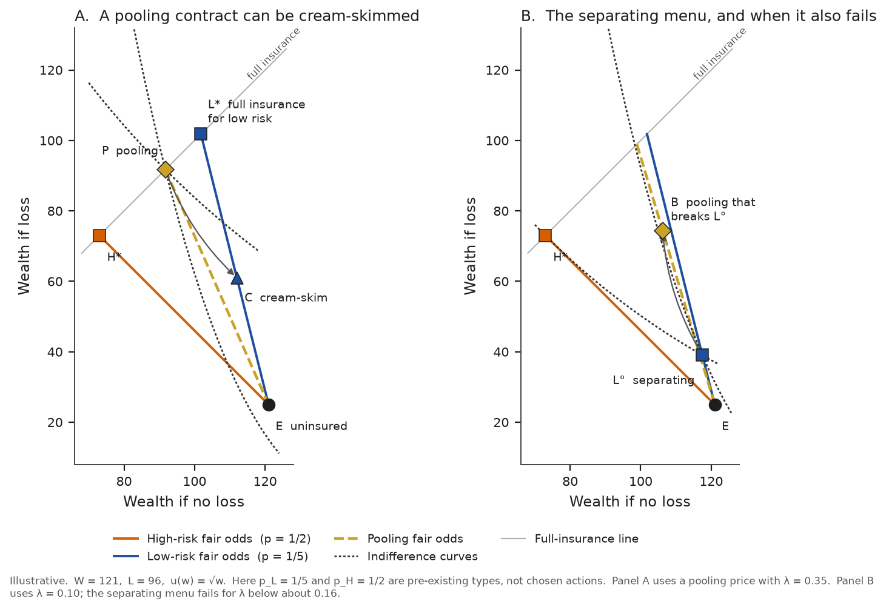

Panel A starts from a pooling contract $P$, full insurance at a pooled price. Through $P$, the low-risk indifference curve is steeper. A contract such as $C$, on the low-risk fair-odds line, is better for the low-risk type, worse for the high-risk type, and profitable if only the low-risk type accepts it. That is why a pooling contract is not an equilibrium. Panel B is the candidate that remains: the high-risk type is fully insured at the high-risk fair price ($H^{\ast}$), and the low-risk type buys a partial contract $L^{\circ}$ that sits on the low-risk fair-odds line and on the high-risk indifference curve through $H^{\ast}$, so the high-risk type will not mimic. Even that menu fails if high-risk types are scarce. In this parameterization the separating menu is broken by a pooling contract such as $B$ whenever the share of high-risk types is below about $0.16$. Rothschild and Stiglitz's possible nonexistence is that fact, not a special pathology of other numbers.

The taxonomy is a map of constraints, not a claim that only one row is present in any market. Health insurance can have hidden types and hidden actions at once. Einav, Finkelstein, Ryan, Schrimpf, and Cullen (2013) estimate a further hybrid, **selection on moral hazard**: people who choose more coverage also have a larger behavioral response to coverage. The hybrid does not collapse the rows. It is a statement about how they covary.

Two tests follow from the table, and they will be used later.

If coverage is randomly assigned, as in the RAND experiment, the path from type to coverage is cut. A difference in use is then a response to coverage, which is the moral-hazard row, not the selection row. If coverage is chosen, a residual correlation between coverage and claims is evidence of some asymmetric information (Chiappori and Salanié 2000). It is not, by itself, evidence of one row rather than the other, because both hidden type and hidden action can produce that correlation.

The same distinction will reappear as a difference in the edges of a graph in Section 6.

## 3. The hidden-action model

This section states the standard principal-agent problem with hidden effort, in notation that the rest of the article will keep. The insurance problem in Section 4 is the same model with a particular outcome (a loss) and a particular contract (an indemnity and a premium). The monitoring problem in Section 5 is the same model with an extra signal. The graph in Section 6 is a picture of the same random variables.

### 3.1 Environment and notation

A **principal** writes a contract with an **agent**. The agent then chooses an action $a$ from a set $A$. The action is not observed by the principal. An outcome $x$ is then realized from a family of distributions $F(x \mid a)$, with density or mass function $f(x \mid a)$. The outcome is observed and can be contracted on.

The contract is a payment $w(x)$ from the principal to the agent, or, in insurance, a premium paid up front and an indemnity paid if a loss occurs. The agent's preferences over money are represented by a Bernoulli utility function $u$, strictly increasing and concave, so the agent is risk averse. The action has a private cost $c(a)$, measured in utility units, with $c$ increasing. The agent's payoff is

$$u(w(x)) - c(a).$$

The principal is often taken to be risk neutral, with payoff $x - w(x)$ in a production setting, or with expected profit $\pi - \mathbb{E}[I]$ in a competitive insurance setting. Risk aversion on the principal's side can be added. It complicates the algebra and does not change the information constraint.

The agent has a reservation payoff $u_0$, the expected utility available outside the relationship.

Throughout, $a$ is the hidden action, $x$ is the contractible outcome, $w$ or $( \pi, I )$ is the contract, $u$ is the agent's utility of money, $c(a)$ is the cost of action, and $u_0$ is the reservation payoff. When a second action or a second task appears, it is $a_2$. When a contractible signal other than $x$ appears, it is $s$. When a pre-existing type appears, it is $\theta$. When a loss amount appears, it is $L$, a deductible is $d$, and a coinsurance rate (the insured's share of the covered loss) is $\alpha$.

### 3.2 The first best

If the action were observable and contractible, the principal could write a contract on $(a, x)$ together. In the usual case of a risk-neutral principal and a risk-averse agent, the first-best contract has two properties.

The agent is fully insured, or, in the production version, is given a sure payment, because risk should be borne by the party better able to bear it. And the action $a^{\mathrm{FB}}$ is chosen to maximize the total surplus, which is the expected outcome, net of the certainty-equivalent cost of compensating the agent for effort and for any remaining risk. Because the action is contractible, the principal can simply require $a^{\mathrm{FB}}$ and punish any deviation.

In insurance language: if prevention were observable, the first-best policy could give full coverage for the financial loss and require the efficient level of prevention, with a penalty if prevention is not taken. The first-best premium would then be the expected indemnity at that efficient action, plus any loading for costs other than incentives.

The first best is the benchmark, not the feasible allocation. It is what the information constraint costs when it is absent.

### 3.3 The second best: participation and incentive compatibility

When $a$ is hidden, the contract can depend on $x$ but not on $a$. The agent, facing $w(\cdot)$, chooses

$$a \in \arg\max_{a' \in A} \int u(w(x)) \, dF(x \mid a') - c(a').$$

This is the **incentive-compatibility** (IC) constraint. It is not a single equation. It is a family of inequalities, one for each alternative action, saying that the recommended action is at least as good for the agent as any deviation.

The agent must also be willing to sign. That is the **participation**, or individual-rationality, constraint:

$$\int u(w(x)) \, dF(x \mid a) - c(a) \ge u_0.$$

The principal's problem, the second-best program, is to choose a contract $w(\cdot)$ and a recommended action $a$ to maximize the principal's expected payoff, subject to IC and participation.

Two consequences follow immediately, and they are the spine of every later section.

If the agent is risk averse and the principal is risk neutral, the first-best sure payment is incentive compatible only if the recommended action is already the agent's private favorite under full insurance. In the interesting case, it is not. Full insurance makes the agent indifferent, or worse than indifferent, toward costly prevention. To implement a costly action, the contract must leave the agent exposed to the outcome. Residual risk is the instrument. It is also a welfare cost, because the agent is risk averse.

The gap between the first-best expected surplus and the second-best expected surplus is the **agency cost** of the information constraint. A worked numerical version is given in Section 3.7 and reused in Section 4.

### 3.4 The first-order approach, and when it fails

When $A$ is an interval, the family of IC inequalities is awkward to work with. A common substitution, the **first-order approach**, replaces that family with the agent's first-order condition: the derivative of the agent's expected payoff with respect to $a$, at the recommended action, is zero.

The substitution is generally invalid. Mirrlees pointed this out in a 1975 manuscript, later published as Mirrlees (1999). His 1976 paper on incentives and authority inside an organization is a related analysis of imperfect observation, but the demonstration that the first-order substitution can fail is the 1975 manuscript. The first-order condition is local. It can hold at an action that is only a local maximum for the agent, or at a point that is not a maximum at all, while a distant deviation is better. In some cases the first-best allocation can be approached by contracts that put heavy penalties on low-probability outcomes, and the local condition then fails to describe the genuine solution.

Rogerson (1985) gives sufficient conditions under which the first-order approach is valid: a **monotone likelihood ratio** condition (MLRC) on $f(x \mid a)$, which says that higher outcomes are evidence of higher action, and a **convexity of the distribution function** condition (CDFC). Under those conditions the optimal payment is nondecreasing in the outcome. Rogerson also notes that an earlier argument of Mirrlees for the same claim contained an error, and supplies a correct proof. Jewitt (1988) provides further, and in some directions weaker, conditions under which the substitution is justified.

Grossman and Hart (1983) avoid the substitution. They split the problem into two stages, which is valid whether or not the first-order approach is. First, for each candidate action $a$, find the cheapest contract that implements $a$, that is, that satisfies IC and participation for that $a$. Under a standard assumption, that the agent's preferences over money lotteries do not depend on the action, this inner problem is a convex program. Second, choose the action whose cost-minimizing contract is best for the principal. The paper also records the reason the first-order approach had been used so freely, and why Mirrlees's observation matters: qualitative claims derived from an invalid substitution are not, in general, properties of the true second-best contract.

For the insurance examples below, the action set will be finite, usually two efforts. IC is then a finite list of inequalities, and no first-order substitution is required. The continuous-action apparatus is in the background when a later section refers to likelihood ratios or to the shape of a payment schedule.

### 3.5 The informativeness principle

Suppose, in addition to $x$, a signal $s$ is observed, with joint distribution $f(x, s \mid a)$. The contract can now be written as $w(x, s)$. Should it depend on $s$?

Holmström (1979) gives the answer known as the **informativeness principle**. Additional information should be used in the contract if and only if it is informative about the hidden action, given the outcome already being contracted on. Equivalently, $s$ can be ignored if and only if $x$ is a sufficient statistic for $(x, s)$ with respect to $a$. If the joint distribution factors so that $s$ adds no information about $a$ once $x$ is known, then any contract $w(x, s)$ can be replaced by a contract that depends only on $x$, without tightening IC or participation and without making the principal worse off. If that factorization fails, there is a contract using $s$ that improves on every contract that ignores $s$.

A discrete, two-outcome version of the same idea does not need the first-order approach. Suppose the outcome is high or low, and high is more likely when the action is high, so the likelihood ratio $f(x^{\mathrm{H}} \mid a^{\mathrm{H}}) / f(x^{\mathrm{H}} \mid a^{\mathrm{L}})$ exceeds $f(x^{\mathrm{L}} \mid a^{\mathrm{H}}) / f(x^{\mathrm{L}} \mid a^{\mathrm{L}})$. Then a contract that implements the high action will pay more in the high-outcome state than in the low-outcome state, because that is the state that is relatively more indicative of the high action. An extra signal is used, in the same spirit, when it changes those likelihood ratios given the outcome.

Figure 3 makes that criterion visible, and distinguishes it from a Blackwell comparison of monitors. In panel A, each cell is the likelihood ratio $f(x,s\mid a^{\mathrm{H}})/f(x,s\mid a^{\mathrm{L}})$, computed from stated illustrative probabilities. On the left, an audit signal still changes the ratio once the outcome $x$ is known, so the contract $w(x,s)$ should use the audit. On the right, the signal is only a noisy reading of $x$, independent of the action once $x$ is known. The ratio no longer depends on the signal given $x$, so $x$ is a sufficient statistic and the signal can be ignored. Panel B is the Blackwell picture: $s_B$ is $s_A$ passed through further noise that does not depend on the action, and every expected-utility decision maker then weakly prefers $s_A$. A principal who already has $s_A$ should not pay for $s_B$ as an incentive instrument. The order is only partial, as Section 5.4 will note.

The illustrative probabilities in panel A are as follows. The high outcome has probability $0.8$ if the action is high and $0.5$ if the action is low. On the left, a "clean" audit has probability $0.75$ if the action is high and $0.25$ if the action is low, and is independent of $x$ given $a$. On the right, the signal reports the high outcome with probability $0.9$ when $x$ is high and $0.2$ when $x$ is low, and is independent of $a$ given $x$.

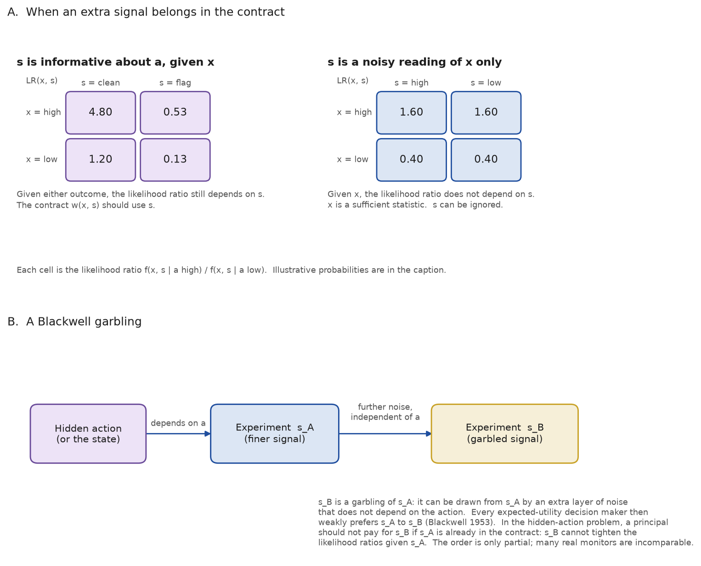

The result is a value-of-information statement for a contract, not only for a single decision maker. Section 5 will push that reading. Two immediate implications are used repeatedly.

A signal can be valuable even if it is not a direct observation of $a$, and even if it is noisy. Weather at a farm, a random audit, a telematic trace, or a second reading of output can all be written into $w$ if they shift the posterior about $a$. And a signal that is merely a garbling of $x$, or that is independent of $a$ given $x$, is worthless as an incentive instrument, however interesting it is for other purposes.

The principle is also a warning. If $s$ is informative about $a$ but is also costly to the agent in some other way, for example as a loss of privacy, the standard model does not automatically count that cost. The contract will use $s$ unless the cost is introduced as a constraint or as an argument of $u$. Section 5.6 and Section 9 take up that gap.

### 3.6 Multitasking

Holmström and Milgrom (1991) extend the hidden-action model to several tasks. Suppose the agent chooses $(a_1, a_2)$, and the principal can measure a signal of $a_1$ well and a signal of $a_2$ badly or not at all. A high-powered incentive on the measured task pulls effort toward $a_1$ and away from $a_2$. The optimal response is often to weaken the incentive on the measured task, or to use a different instrument, such as a restriction on the agent's other activities or an allocation of ownership.

The 1987 paper by the same authors gives conditions, in a continuous-time Brownian setting with exponential utility, under which the optimal incentive scheme is linear in an aggregate of outcomes. That result is the usual formal reason to study simple linear sharing rules, including coinsurance, rather than highly nonlinear payment schedules.

In insurance, multitasking is not an ornament. A contract that punishes reported claims can induce prevention. It can also induce the under-reporting of legitimate claims, or a substitution away from forms of care and maintenance that do not show up in the measured statistic. A health plan that cost-shares some services and not others will shift use toward the uncovered or the less-shared service. The informativeness principle still applies, but it applies task by task, and a signal that is informative about the measured task may be uninformative, or misleading, about the unmeasured one.

### 3.7 An illustrative numerical example

The following example is invented for calculation. It is not estimated from data.

An agent has wealth $W = 121$ and faces a possible loss $L = 96$. Preferences over final wealth are $u(w) = \sqrt{w}$. The agent chooses a prevention action $a \in \{0, 1\}$, with cost $c(0) = 0$ and $c(1) = 1$, measured in utility units. The loss occurs with probability $q(0) = 1/2$ if prevention is low, and with probability $q(1) = 1/5$ if prevention is high. A risk-neutral insurer offers insurance at a zero expected profit, conditional on the action it is trying to implement. The agent's reservation payoff is the best uninsured expected utility, which, as will be seen, is the uninsured high-prevention payoff.

Without insurance, expected utilities are

$$\mathrm{EU}(a=0) = \tfrac12 \sqrt{121} + \tfrac12 \sqrt{25} = 8,$$

$$\mathrm{EU}(a=1) = \tfrac45 \sqrt{121} + \tfrac15 \sqrt{25} - 1 = 8.8.$$

The agent would take high prevention even without insurance, and would have expected utility $8.8$.

If prevention were observable, the first-best contract would fully insure the agent and require $a = 1$. The premium would be the expected loss at high prevention, $\pi^{\mathrm{FB}} = 0.2 \times 96 = 19.20$. Final wealth would be $121 - 19.20 = 101.80$ in both states, with

$$\mathrm{EU}^{\mathrm{FB}} = \sqrt{101.80} - 1 \approx 9.090.$$

Full insurance at the low-prevention premium is worse for the agent than this, so the first-best action is high prevention with full cover. The first-best surplus, relative to going uninsured, is about $0.290$ in utility units.

That contract is not incentive compatible once prevention is hidden. If the agent is fully insured at $\pi = 19.20$, final wealth no longer depends on whether the loss occurs, and the agent will set $a = 0$ to avoid the cost of prevention. The insurer, expecting a loss with probability $0.2$ and facing a loss with probability $0.5$, would then lose $28.80$ in expectation. Full insurance at a premium that assumes high prevention unravels.

To implement $a = 1$ when prevention is hidden, the insurer can use coinsurance. The agent pays a share $\alpha$ of any loss, the insurer pays $(1-\alpha)L$, and the premium is set at the high-prevention expected indemnity, $\pi = 0.2(1-\alpha)96$. The smallest such $\alpha$ that makes high prevention at least as good for the agent as low prevention is

$$\alpha^{\ast} \approx 0.625,$$

with premium $\pi \approx 7.20$. Final wealth is then about $113.80$ if the loss does not occur and about $53.79$ if it does. The agent's expected utility is about $9.001$.

Two remarks on these numbers.

In a model with a single loss size, coinsurance at rate $\alpha$ and a deductible of $d = \alpha L$ are the same contract. Here that deductible is about $60.01$. The two instruments will come apart once losses can take more than one size, which is why both names are worth keeping.

The second-best expected utility, $9.001$, is better than going uninsured, $8.8$, by about $0.201$, and worse than the first best, $9.090$, by about $0.088$. That last gap is the agency cost of hidden prevention in this example. Residual risk is how the contract buys the high-prevention action, and residual risk is what the risk-averse agent dislikes. The next section is this trade-off, written as insurance design.

Figure 4 is the same calculation as a picture. Panel A is the plane of wealth in the two states. The uninsured point is $(121, 25)$. The first-best contract is the sure point $101.80$ on the full-insurance line, at the high-prevention fair-odds price. The second-best contract sits on that same fair-odds line, but off the diagonal, at about $(113.80, 53.79)$: residual risk is how the contract buys $a = 1$. Panel B traces expected utility against the coinsurance rate, with the premium held at the zero-profit indemnity for $a = 1$. The two curves cross at $\alpha^{\ast} \approx 0.625$, where incentive compatibility begins to bind. To the left of that threshold the agent would take $a = 0$, and the drawn premium would be unsustainable. The vertical gap between the first-best value and the value at $\alpha^{\ast}$ is the agency cost, about $0.088$.

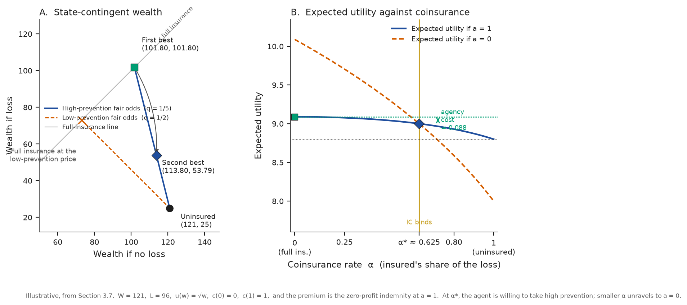

## 4. Insurance as the leading case

Insurance is not an application pasted onto the model. It is the setting in which the model was first pressed into empirical and institutional work, and it is the setting in which the later questions about information, transparency, and on-chain design are most naturally asked.

### 4.1 Why full insurance fails

A risk-averse person and a risk-neutral, or less risk-averse, insurer can both gain from a contract that transfers a financial loss. In the first best, with no hidden action and no hidden type, and with a fair or modestly loaded premium, Mossin (1968) and the related literature on optimal insurance purchasing imply that a risk-averse buyer wants full coverage when the premium is actuarially fair, and wants a deductible when the premium is loaded above the expected indemnity. Raviv (1979) studies the broader design of an optimal policy.

Hidden action changes the feasible set. Full insurance, as in Section 3.7, makes the agent's wealth independent of the loss, and so independent of the action that shifts the loss. If that action is costly, it is not taken. The insurer cannot then sell full cover at a premium that assumes the first-best action. This is Pauly's (1968) point, and Arrow (1968) accepted it. Zeckhauser (1970) put the same tension in the language of a trade-off between risk spreading and incentives, in a medical-insurance model.

Spence and Zeckhauser (1971) already treat insurance as an individual-action problem under imperfect information, and so sit on the same line. The later principal-agent papers supply the general apparatus. Shavell (1979) analyzes insurance when care may be observed completely, observed incompletely, or observed not at all, and shows how observation of care, and instruments such as experience rating, enter the second-best contract.

### 4.2 Deductibles, coinsurance, and experience rating

Three classical instruments leave residual risk with the insured, in different shapes.

A **deductible** $d$ assigns the first dollars of a loss to the insured. The indemnity on a loss $L$ is $\max(L - d, 0)$. In the first-best problem with a loaded premium and no hidden action, a positive deductible is the standard optimal form (Mossin 1968). In the hidden-action problem, a deductible also creates an incentive to prevent losses, or to limit their size, in the region where the insured still pays.

A **coinsurance** rate $\alpha$ is a linear sharing rule: the insured pays $\alpha$ of the covered loss, the insurer pays $1-\alpha$. In the binary-loss example of Section 3.7, a deductible and a coinsurance rate are the same contract, because there is only one positive loss size to share. When losses can be small or large, the two instruments differ. A deductible concentrates the insured's exposure on the first layer. Coinsurance spreads it across the covered layer. Copays, a fixed amount per use, are a close cousin, used especially when the "loss" is a visit or a prescription rather than a dollar amount drawn from a continuous distribution. Holmström and Milgrom (1987) give a setting in which a linear share is itself the optimal form, which is one reason coinsurance is more than an ad hoc simplification.

Figure 5 shows why both names are worth keeping once losses can vary. The two instruments are calibrated to be the same contract at the single loss of Section 3.7: a deductible $d \approx 60$ and a coinsurance rate $\alpha \approx 0.625$ each leave $60$ with the insured when $L = 96$. For a smaller loss, the deductible pays nothing and coinsurance still shares. For a larger loss, the deductible caps the insured's out-of-pocket at $d$, and coinsurance does not. A deductible concentrates residual risk on the first layer. Coinsurance spreads it.

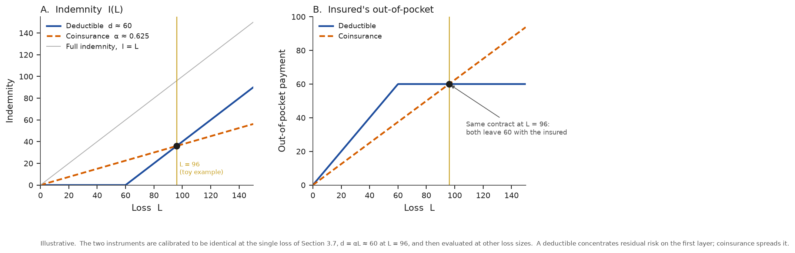

**Experience rating**, and the **bonus-malus** or no-claims-discount systems used in motor insurance, make the future premium a function of past claims. The insured then internalizes part of the future cost of a claim, even if this year's deductible is small. The same arithmetic, from the other direction, is credibility formula: more of this insured's own history is trusted as evidence of the risk, and less of the book rate is used. In the hidden-action model the history is a signal $s$, and the informativeness principle says to use it if it carries information about $a$ that the current claim does not already contain. Past claims usually do.

Figure 6 is that incentive, drawn as a Markov chain. The transition rule is illustrative: a claim-free year moves the insured one rating class better, a claim one class worse, and a class at either end of the scale does not move further in that direction. The claim probability is not an exogenous frequency. It is $q(a)$ from Section 3.7. Under low prevention the stationary distribution is uniform on the three classes. Under high prevention it is $(16/21, 4/21, 1/21)$, with most of the mass in the best class. Today's action moves the future premium, which is why a bonus-malus rule can support prevention even when this year's deductible is small.

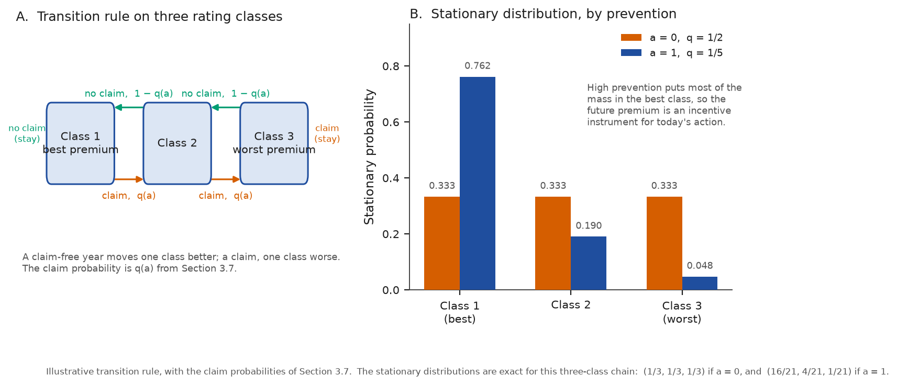

Each instrument has a multitasking shadow. A large deductible may deter useful small claims, including preventive visits, as well as wasteful ones. Experience rating may deter reporting. Coinsurance on some services and not others will redirect use. These are not reasons to discard the instruments. They are reasons to measure more than one outcome, and to remember Holmström and Milgrom (1991) when only one outcome is easy to write into the contract.

### 4.3 The optimal-insurance trade-off, and the Baily-Chetty formula

The second-best problem can be read as a balance. On one side is the gain from smoothing consumption, which is larger when the agent is more risk averse and when the uninsured consumption drop is larger. On the other side is the cost of the behavioral response, the moral-hazard term, which is larger when the action is more elastic with respect to the indemnity or the benefit.

Baily (1978) derived an inverse-elasticity rule of this kind for unemployment insurance. Chetty (2006) shows that a close relative of that rule holds under much weaker assumptions about borrowing constraints, durable goods, and the structure of the underlying model. In Chetty's exact first-order condition, equation (8) in that paper, the gap in marginal utilities between the unemployed and employed states is set equal to an elasticity term. With $c_u$ and $c_e$ denoting consumption in the two states, $b$ the benefit, and $D$ unemployment duration,

$$\frac{u'(c_u) - u'(c_e)}{u'(c_e)} = \frac{b}{D}\frac{dD}{db}.$$

The right-hand side is the elasticity of duration with respect to the benefit, $\varepsilon_{D,b}$. The left-hand side is the proportional gap in marginal utilities, the consumption-smoothing gain of a slightly higher benefit. Chetty then expands the left-hand side in a Taylor series. When third- and higher-order terms in $u$ are neglected, which is Baily's approximation, the condition reduces to

$$\gamma \cdot \frac{\Delta c}{c} \approx \varepsilon_{D,b},$$

where $\Delta c / c = (c_e - c_u)/c_e$ is the consumption drop in unemployment, and $\gamma = -u''(c_e)c_e / u'(c_e)$ is the coefficient of relative risk aversion, evaluated at employed consumption (Pratt 1964). This is the first approximation in Chetty's Proposition 1, which he identifies with Baily's formula. If a prudence term is kept, a second-order correction appears. The formula implicitly defines the optimal $b$, because both the consumption drop and the elasticity may depend on $b$.

Two comments keep the formula in its proper place.

It is a condition for a social planner choosing a benefit and a tax that finances it. It is not, by itself, a pricing formula for a private insurer. The same trade-off, however, is the one a private contract is negotiating when it chooses $d$ or $\alpha$: a little more indemnity buys smoothing and, through the behavioral response, a higher expected claim.

Chetty (2008) also distinguishes liquidity effects from moral-hazard effects in the unemployment-duration response. A benefit can lengthen unemployment by making it less urgent to take a job, which is the incentive term, or by relaxing a borrowing constraint, which is a liquidity term with a different welfare reading. The distinction is a reminder that an elasticity, uninterpreted, is not yet an agency cost.

### 4.4 Separating moral hazard from selection

A positive association between coverage and claims has two leading explanations, and they correspond to two rows of the table in Section 2.4.

Under adverse selection, higher-risk types buy more coverage, and they also have more claims, even if coverage does not change their behavior. Figure 2 is that sorting, in wealth space. Under moral hazard, coverage changes behavior, and claims rise because of the contract, even if types are identical. Both stories predict that, after conditioning on what the insurer observes, more coverage should go with more claims.

Chiappori and Salanié (2000) formalize that prediction as a **positive-correlation test**. In their French automobile data they do not reject the null of no residual correlation. The test is a test of some asymmetric information, not of one source. A failure to reject is also not a proof that neither source is present. It may be a fact about that market, that period, and that conditioning set.

Separating the two sources requires a variation in coverage that is not chosen on the basis of type, or a model that can trace demand and cost curves separately. Einav, Finkelstein, and Cullen (2010) use price variation at an employer to trace those curves and to measure the welfare cost of selection. Einav, Finkelstein, Ryan, Schrimpf, and Cullen (2013) estimate selection on moral hazard, a covariance between the taste for coverage and the size of the behavioral response. Both papers use confidential employer microdata, which are not public. Their contribution to this article is the identification strategy, not a number that can be recomputed here.

The cleanest separation in health insurance is still random assignment of coverage, which cuts the edge from type to contract. That is the design of the experiments in the next subsection.

### 4.5 What the experiments show, and what they do not

The RAND Health Insurance Experiment assigned families at random to plans with different cost sharing. Because assignment is random, differences in use are not an artifact of who chose which plan. Manning, Newhouse, Duan, Keeler, Leibowitz, and Marquis (1987) report, in the paper's abstract, that a catastrophic plan reduces expenditures 31 percent relative to a zero out-of-pocket price, and that the price elasticity is approximately $0.2$ in absolute value. Those two figures are taken from the abstract, not from a new run of the microdata. Aron-Dine, Einav, and Finkelstein (2013) review the design and later re-analyses, including questions about how to treat the nonlinear budget sets that deductibles and out-of-pocket maxima create. The review is the right place to go for those caveats. The headline RAND result, that use responds to the out-of-pocket price, is the empirical core of ex post moral hazard in health care, and it is also the reason a single elasticity of $-0.2$ is at best a rough calibration for a model, not a universal constant.

The Oregon Health Insurance Experiment used a 2008 lottery for a limited number of Medicaid spots. Finkelstein, Taubman, Wright, Bernstein, Gruber, Newhouse, Allen, Baicker, and the Oregon Health Study Group (2012) study the first year. The group selected by the lottery was about 25 percentage points more likely to have insurance than the group that was not. In that first year the selected group had higher health-care utilization, including primary and preventive care and hospitalizations, lower out-of-pocket medical spending and medical debt, and better self-reported physical and mental health. The lottery identifies the effect of winning access to Medicaid, not a deductible elasticity inside a private contract, and not an effect of insurance on every health outcome that later commentary has sometimes claimed for it. It is evidence that coverage changes use and financial strain, in a low-income adult population, under a public program.

Limits should travel with these results. RAND's population and period are not the present United States health-care system, and Oregon's lottery is not a private insurance menu. Neither experiment is a test of adverse selection, because assignment is not a chosen contract. Neither is a test of ex ante prevention in the Ehrlich-Becker sense, except insofar as some of the measured use is preventive care. The microdata are available under archive terms, at ICPSR for RAND and at the NBER for Oregon, and they are not reproduced here.

What the experiments establish, for the argument of this article, is limited and strong. The hidden-action response in health use is not a theoretical curiosity. It is large enough to measure. It is also not the whole of the welfare analysis, because the same coverage that raises use can reduce financial strain and may improve some measures of health.

## 5. The value of information under asymmetric information

The informativeness principle is already a claim about the value of a signal in a contract. It is worth placing that claim next to the older, single-person theory of the value of information, because the two theories do not say the same thing, and the difference is the difference between a decision and a market.

### 5.1 A single decision maker: EVPI and EVSI

Consider a single agent who must choose an action, not necessarily a hidden one, under uncertainty about a state $\omega$. Before a signal arrives, the agent chooses the action that maximizes expected utility under the prior. After a signal $s$ arrives, the agent updates and chooses again. The **expected value of sample information** (EVSI) is the increase in expected payoff, usually converted into money by a selling price or a certainty equivalent, that the signal is worth. The **expected value of perfect information** (EVPI) is the same quantity when $s$ reveals $\omega$ exactly. Howard (1966) sets this out as information-value theory: no imperfect signal can be worth more than perfect information, and EVPI is therefore an upper bound on what a decision maker should pay for any experiment that informs the same uncertainty.

For a single expected-utility maximizer, free information cannot lower expected utility. The agent can always ignore the signal. If the signal is used, it is used because it raises expected utility. That is the decision-theoretic baseline.

### 5.2 When information can hurt: the Hirshleifer effect

Hirshleifer (1971) showed that this baseline need not hold when information interacts with a risk-sharing market. Information about a state of the world has private value if it allows a person to take a better-informed position. The social value of that same information can be smaller, and in some cases the information can destroy the insurance market that would have shared the risk before the state was known. If, before any contract is signed, it becomes public who will be ill, or whose house will burn, then the soon-to-be-unlucky cannot buy insurance except at a price that already reflects the loss, and the soon-to-be-lucky do not wish to buy it. Risk-sharing has to take place behind a veil that the information removes.

This possibility is often called the **Hirshleifer effect**. The name is later than the paper. The mechanism is in the paper: the private and social values of information come apart, and "foreknowledge" can have a social value below its private value because it interferes with efficient risk bearing.

The contrast with Section 5.1 is sharp, and it will matter for genetic testing and for any proposal to make risk more transparent before a contract is struck. In a single-person problem, a better signal about $\omega$ is weakly valuable. In a market whose purpose is to share risk over $\omega$, a public signal about $\omega$, arriving before trade, can be harmful. Moral hazard is a problem of hidden action after, or under, a contract. The Hirshleifer effect is a problem of revealed state before a contract. Both are information problems. They recommend opposite attitudes toward disclosure.

Figure 7 computes the contrast, with $u(w) = \sqrt{w}$ and $W = 121$ in both panels, and with every other parameter stated. The two panels are different decision problems. What is to be compared is the sign of the value of information.

In panel A, a loss of $96$ occurs with probability $1/2$, and a mitigation outlay of $40$ cancels it. Without information the agent always mitigates, because a sure wealth of $81$ (expected utility $9$) is better than the unmitigated gamble (expected utility $8$). With perfect information the agent mitigates only when the loss is coming, and expected utility rises to $10$. The expected value of perfect information is $+1$.

In panel B there is no mitigation, only a fair risk-neutral insurer. Before any revelation, fair full insurance yields a sure wealth of $73$ and expected utility $\sqrt{73} \approx 8.544$. If the loss state is announced before trade, the unlucky cannot insure except at a price that already is the loss, and the lucky do not wish to. Ex ante expected utility falls to $8$. The social value of that public information is about $-0.544$.

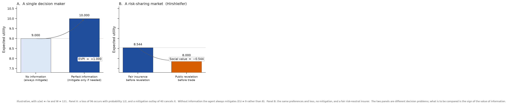

### 5.3 Monitoring as a purchased signal

Return to the hidden-action contract. A monitor is a technology that produces a signal $s$ at a cost. The informativeness principle says when $s$ belongs in $w(x, s)$. The value-of-information question is what the principal should pay for the technology.

The answer is the increase in the principal's expected payoff when the second-best program is enlarged to include $s$, net of the cost of producing $s$. If $s$ is uninformative about $a$ given $x$, that increase is zero, and the principal should pay nothing. If $s$ is informative, the increase is positive, and it can be read as an EVSI for a contractual relationship rather than for a single decision. Unlike the single-person EVSI, the gain here comes from a loosening of IC. A better signal allows the same action to be implemented with less residual risk on the agent, or allows a more valuable action to be implemented at the same residual risk. That is the first-best made nearer, which is why monitoring and deductibles are substitutes as well as complements: a little more information can justify a little more insurance.

A random audit, a medical-record review, a second appraiser, or a telematic device are all purchased signals in this sense. Their value is not the beauty of the data. It is the change in the second-best surplus.

### 5.4 Blackwell comparisons

Blackwell (1953) gives a partial order on experiments, that is, on signal technologies. Experiment $s_A$ is **more informative** than experiment $s_B$, in Blackwell's sense, if every decision maker, regardless of payoff function and prior (within the standard expected-utility setting), weakly prefers $s_A$ to $s_B$. Equivalently, $s_B$ is a garbling of $s_A$: $s_B$ can be represented as $s_A$ passed through a further layer of noise that does not depend on the state. Panel B of Figure 3 is that factoring.

Where the Blackwell order applies, it is a strong statement: a more informative monitor is more valuable for the hidden-action problem, at least before the cost of the monitor and any non-standard costs such as privacy are counted, because it is more valuable for every use of the information, including the inference about $a$. The order is only partial. Many pairs of real monitors are incomparable. One monitor may be better at detecting low effort in one region of the outcome space, and the other may be better elsewhere. The informativeness principle still applies to each, and the principal's willingness to pay still compares them, but the comparison then depends on the particular payoff and on the particular $A$.

### 5.5 What a principal should pay for a signal

Collecting the pieces: the most a principal should pay for a monitor is the rise in second-best surplus that the monitor produces. That rise is zero if $x$ is already a sufficient statistic for $(x, s)$ with respect to $a$. It is bounded above, in the obvious sense, by the agency cost of the information constraint, because even a perfect observation of $a$ cannot be worth more than the gap between first best and second best. A perfect observation of $a$ restores the first best, and is therefore worth exactly that gap, minus any direct cost of the observation.

In the illustrative example of Section 3.7, the agency cost was about $0.088$ in utility units. A perfect, costless observation of prevention would be worth that amount to a planner who internalizes the agent's utility, or the corresponding expected-profit amount to an insurer that still has to compensate the agent for participation. An imperfect monitor is worth less. A monitor that is a garbling of the loss itself is worth nothing as an incentive device.

These are statements about willingness to pay for incentive information. They are not statements about what a court, a regulator, or a professional norm will allow the principal to observe. The next subsection is that restriction in two live cases.

### 5.6 Telematics and genetic testing

**Telematics**, and usage-based automobile insurance more generally, are a purchased signal about driving, which is an ex ante action. Edlin (1999) analyzes per-mile premiums as a way to price the marginal mile, which is a simple, highly informative signal: miles driven. A device that records speed, braking, and time of day is, in principle, a finer experiment in the direction Blackwell described, and the informativeness principle says to use it if it is informative about hidden driving conduct given the claims already observed. The privacy cost is the part the standard model will ignore unless it is put in. A driver who dislikes being watched will require compensation, or will refuse the contract, and the refusal is a participation constraint, not a failure of informativeness.

**Genetic testing** is a different signal. A test that reveals a predisposition is, in the taxonomy of Section 2.4, closer to information about type $\theta$ than to information about a later action $a$. If the test result becomes public, or can be demanded by an insurer, before a health-insurance contract is struck, the Hirshleifer mechanism is the relevant one. Risk that was insurable behind the veil of genetic ignorance may cease to be insurable once the veil is lifted, except at premiums that already track the revealed risk. The United States, in the Genetic Information Nondiscrimination Act of 2008 (GINA), Public Law 110-233, generally prohibits health insurers from using genetic information to set eligibility or premiums, and generally prohibits employers from using it in employment decisions. That statute is a legal choice to keep a particular signal out of a particular class of contracts. It can be read, in the language of this section, as a decision to protect the risk-sharing market against a Hirshleifer unraveling, and also as a decision about privacy and fairness, which Section 9 will take up directly.

The two cases should not be collapsed. A telematic signal is mainly about a chosen action under an existing contract, and its incentive value is the informativeness-principle value. A genetic signal is mainly about a pre-existing type, and its public disclosure can shrink the set of risks that insurance can still share. A technology can of course produce both kinds of information at once. The graph in the next section is a way to keep them from being confused.

## 6. Transparent insurance and probabilistic graphical models

A contract, a hidden action, a type, a signal, and a loss are random variables with a directed structure. Drawing that structure does two pieces of work at once. It is a compact restatement of Sections 2 through 5, and it is a proposal for what "transparent" pricing could mean: an auditable model of which variables cause which, and of which of those variables the premium is allowed to depend on.

### 6.1 An influence diagram of the insurance relationship

An **influence diagram** (Howard and Matheson, originally circulated in 1981, reprinted in *Decision Analysis* in 2005) extends a Bayesian network by marking some nodes as decisions and some as values. For the present purpose a directed acyclic graph on random variables is enough, with the premium and the indemnity treated as decisions that have been made into functions of their observed parents.

The following graph is a schematic. It is not estimated. A directed graph used as a Bayesian network has to be acyclic, so signals that are available before the contract is chosen are separated from signals that are produced during the life of the contract. The first are $s_{\mathrm{pre}}$: underwriting variables, a pre-contract test, a public type-signal. The second are $s_{\mathrm{post}}$: a telematic trace, an audit, a second reading of the claim. The contract can be written as a rule that will later use $s_{\mathrm{post}}$, but the realized value of $s_{\mathrm{post}}$ does not choose the contract. That timing is what keeps the graph acyclic.

Nodes that are typically hidden from the insurer, at contracting or at settlement, are marked as hidden in Figure 8 unless a monitor is added.

```
s_pre (test,            θ type (hidden)           a prevention (hidden)
 underwriting)               |    \                /  \
      \                      |     \              /    \
       \                     v      v            v      v
        \-------------> coverage            L loss     m utilization
                         (π, contract)         \        /
                              |                 \      /
                              |                  v    v
                              |               k claim
                              |                   |
                              v                   v
                         s_post (telematics,   I indemnity
                          audit)  <---- a, θ      ^
                              \                   |
                               \------------------+
                                    (contract rule
                                     may use s_post)
```

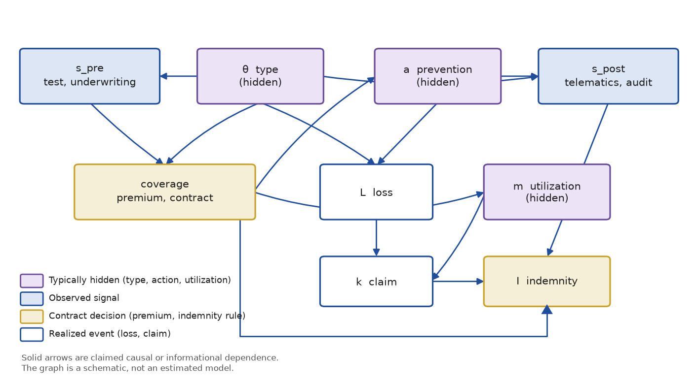

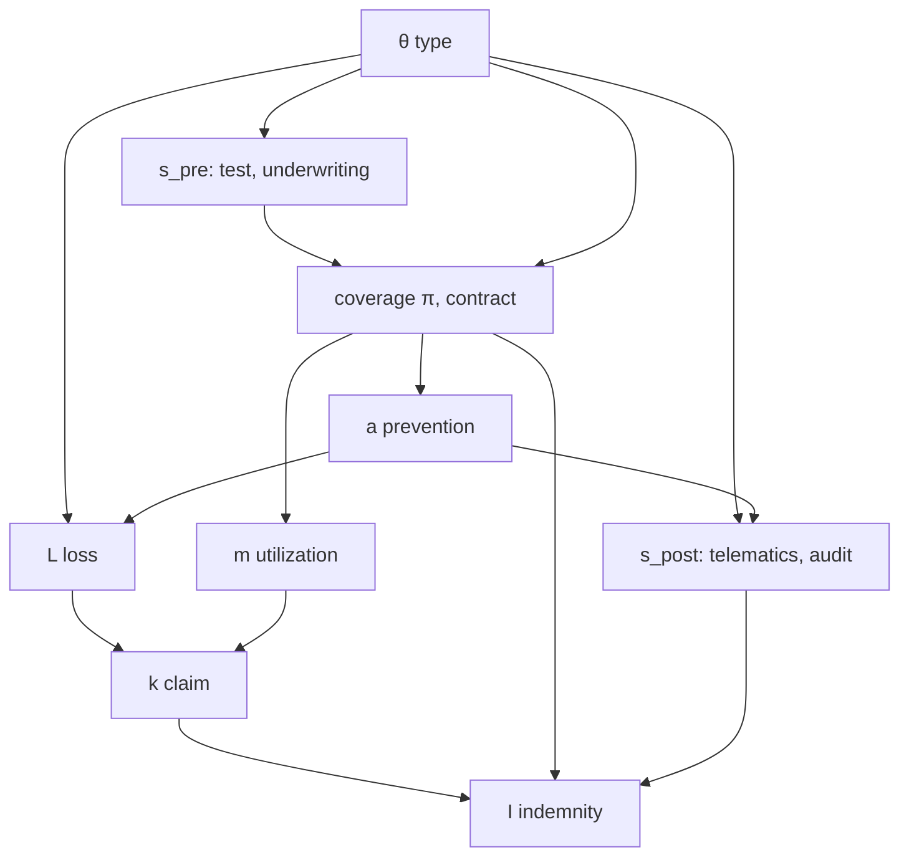

The edge $\theta \to$ coverage is the adverse-selection, or signaling, or screening edge: type influences the contract that is chosen or offered. The edge $s_{\mathrm{pre}} \to$ coverage is the same family when a pre-contract signal is used, and it is also the Hirshleifer path if $s_{\mathrm{pre}}$ reveals the state before trade. The edges coverage $\to a \to L$ are ex ante moral hazard: the contract changes prevention, and prevention changes the chance of a loss. The edge coverage $\to m$ is ex post moral hazard: the contract changes utilization after a loss. The edges into $s_{\mathrm{post}}$ say that a later signal may be informative about type, or about action, or about both. The edge $s_{\mathrm{post}} \to I$ says that the indemnity rule may use that later signal, which is the informativeness principle applied during the life of the contract.

### 6.2 Hidden and observed edges

At contracting, the insurer typically observes a short vector of underwriting variables, which can be thought of as a coarse $s$, and does not observe $\theta$ or future $a$. At settlement, the insurer observes a claim $k$, and perhaps a further investigation, and still may not observe $a$ or $m$ except insofar as they are reflected in $k$. A telematic feed makes a component of $a$ more nearly observed. A genetic test makes a component of $\theta$ more nearly observed. An audit makes a component of $k$ or of $m$ more nearly observed.

Transparency, in the sense of this section, is not the same as revealing $\theta$ or $a$ to the world. It is a statement about the model: which edges are claimed, which nodes the premium is a function of, and which queries the model can answer. A contract can be transparent in that sense and still protect some nodes from disclosure, which is exactly what a statute such as GINA does for a class of genetic signals in health coverage.

### 6.3 d-separation and testable implications

Pearl (1995) defines **d-separation** as the graphical criterion for when a set of nodes $Z$ makes $X$ and $Y$ conditionally independent in any distribution that factors according to the graph. A path is blocked, roughly, by conditioning on a non-collider on the path, or by not conditioning on a collider or its descendants. If every path between $X$ and $Y$ is blocked by $Z$, then $X \perp Y \mid Z$.

The moral-hazard story and the adverse-selection story are different graphs, and they imply different independencies.

In a graph whose only path from coverage to claims runs through $\theta$ (type as a common cause, no causal edge from coverage to $L$ or $m$), random assignment of coverage, or any intervention that cuts the incoming edges to coverage, removes that path. Coverage and claims should then be independent. If they are not, the graph is missing a causal edge from coverage to use or to loss, which is the moral-hazard story. This is why the RAND assignment identifies a utilization response. In the language of the graph, the lottery or the random plan is a $do(\text{coverage})$ operation, and the remaining association is along a causal path.

In a graph that has both $\theta \to$ coverage and $\theta \to L$, and also coverage $\to m$ or coverage $\to a \to L$, a residual correlation between chosen coverage and claims, after conditioning on the observed parents of both, is consistent with either remaining path, or with both. That is why the Chiappori-Salanié test is a test of asymmetric information and not a test of one row of the taxonomy. To separate the paths one needs an instrument or a randomization that moves coverage without moving $\theta$, or a set of nodes that d-separates $\theta$ from the comparison, or a structural model that uses more than the one correlation.

The same criterion distinguishes a signal about action from a signal about type. If $s$ is caused only by $a$, then once $a$ is (hypothetically) known, $s$ is independent of $\theta$. If $s$ is caused only by $\theta$, then once $\theta$ is known, $s$ is independent of $a$. A real telematic device or a real medical test may have edges from both, which is why a single "information improves insurance" slogan is not a substitute for a graph.

These independencies are predictions. They are only as good as the graph. The value of writing the graph is that the predictions are then explicit, and can be wrong in a way that can be checked.

Figure 9 is that claim as two subgraphs of Figure 8. The left column is coverage chosen; the right column is coverage assigned, a $do(\text{coverage})$ intervention that cuts incoming edges to the contract. In an adverse-selection-only graph, the intervention leaves coverage and claims independent. In a graph with a moral-hazard path, the association remains, and that remainder is what a RAND-style assignment measures. The Chiappori-Salanié positive-correlation test is a test of some remaining path in the left column, not of one row of the taxonomy against the other.

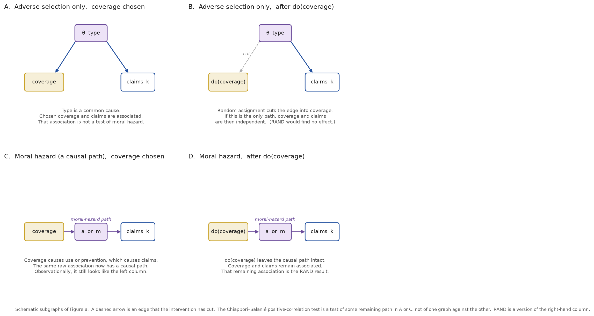

### 6.4 What "transparent" pricing can mean

Three meanings of transparency are often mixed, and they should be separated.

**An auditable model.** The insurer publishes, or deposits with a referee, the graph, the functional form of the premium as a function of its observed parents, and the data definition of each parent. A third party can recompute a premium from the same inputs. This is transparency of a pricing function. It does not require that hidden actions or hidden types be revealed.

**An explainable premium.** For a particular insured, the model can report which observed parents moved the premium, and by how much, relative to a stated baseline. This is a local explanation, and it is only as honest as the model. A model that omits a parent, or that is fitted in-sample to a proxy for $\theta$, can produce a fluent explanation of the wrong thing.

**A counterfactual query.** The model can be asked what the premium would have been if a signal had taken a different value, or what the expected loss would have been if prevention had been high. The second of those queries is a counterfactual about a hidden node, and it is identified only under assumptions that the graph must state. Randomization of coverage, as in RAND, identifies a related interventional query about use. It does not, by itself, identify a counterfactual about an individual's unobserved prevention.

A pricing rule can be auditable and still be ethically contested, if one of the observed parents is a variable that a given normative view says should not be used. Transparency of the function is then a help, because the contest is about a named parent rather than about a black box. It is not a resolution of the contest. Section 9 is that contest.

On-chain publication of a pricing function, or of a graph, is one way to make an auditable model harder to alter quietly. It is a commitment technology for the first meaning of transparency. It does not, on its own, supply identification for the third, and it does not make a hidden action observable. That is the right place to turn to Bitcoin-backed and on-chain insurance, with the grammar already in hand.

## 7. Bitcoin-backed and on-chain insurance

This section is deliberately split between what is established in the insurance and information literature, and what is a proposal or a working protocol. The second class is marked as such. A cryptographic settlement asset, a public ledger, and a smart contract compiler do not cancel the information constraint of Sections 3 through 5. They change which events are cheap to contract on, who can alter the contract after the fact, and in what unit the collateral is held.

### 7.1 What is established, and what is speculative

Established, and used below: the hidden-action model; the informativeness principle; the Hirshleifer possibility that early public information can shrink risk sharing; the fact that a contract written on an index rather than on an individual loss trades moral hazard for basis risk (Doherty and Richter 2002); and the ordinary arithmetic of collateral, reserves, and denomination.

Speculative, or at least not settled by the same literature: the claim that moving insurance onto a blockchain "solves" moral hazard; the long-run viability of any particular protocol; and the claim that a hard-money collateral asset is, by itself, a substitute for underwriting. Those claims are not endorsed here. They are examined.

### 7.2 Collateral and reserves

A pool that holds, in identifiable collateral, at least the maximum amount it could have to pay on the covers it has written is **fully reserved** in a simple sense. A pool that holds less, because it invests, leverages, or relies on the power to levy or to borrow if claims exceed assets, is in that same simple sense **fractionally reserved**. Traditional insurance is heavily regulated on this dimension, and it is not, in general, a box of cash equal to maximum possible claims. It is a portfolio, a capital requirement, and a set of reinsurance contracts.

An on-chain pool can make the reserve **observable**. That is a transparency gain of the first kind in Section 6.4: a third party can, in principle, check that the collateral is there, and that it is committed to a stated rule. Observability of collateral is not observability of $a$ or of $\theta$. A fully reserved pool can still be under-priced if hidden action or hidden type is ignored, and it can then fail to accept new risk, or can pay later claimants on a thinner residual, even though a snapshot of the wallet looked adequate on the day the cover was sold.

A fully reserved design does avoid one particular moral hazard, the hidden action of the insurer or the pool manager who takes extra asset risk after the premium has been paid. That is not a small thing. It is also not the insured's hidden action, which was the original problem.

### 7.3 Parametric triggers, oracles, and a new hidden action

A **parametric** contract pays when a stated index crosses a threshold: wind speed at a weather station, a chain reorganization of a stated depth, a reported earthquake magnitude, a price drawdown. The index, not the claimant's documented loss, is the contractible event. Individual claims adjustment is then unnecessary, and the ex post hidden action of inflating a loss, or of inflating a repair, is largely removed.

The price of that removal is **basis risk**, the mismatch between the index payment and the claimant's actual loss (Doherty and Richter 2002; see also Cummins, Lalonde, and Phillips 2004, on basis risk in catastrophic-loss index securities). A household can have a genuine loss and receive nothing, because the station did not record the threshold, or can receive a payment without a genuine loss. Doherty and Richter study how a parametric or index layer can be combined with a more conventional layer, and how the residual "gap" is itself an insurance problem. Their analysis is not about blockchains. It applies to any contract that substitutes an index for an indemnity.

Someone has to report the index. In an on-chain contract that someone is an **oracle**, or a committee of oracles. The report is a signal $s$, and the payment is $w(s)$, not $w(L)$. If the oracle can misreport, a new hidden action has been created at a new node. The informativeness principle still applies, now to the design of the oracle: multiple independent reports, a dispute window, a stake that can be slashed, a reputation. Those are monitors and residual-risk instruments, pointed at the oracle rather than at the insured. They have costs, and they have their own incentive-compatibility constraints. It would be a mistake to say that parametric on-chain insurance has no moral hazard. It has moved the hidden action, and it has bought that move with basis risk.

Figure 10 is both halves of that rule. Panel A is an illustrative scatter, not an estimated market: an index $Y$ and a loss $L$ are positively dependent but not identical, and the contract pays a fixed $80$ if $Y$ exceeds $50$, otherwise nothing. Points off the 45-degree line are basis risk. Some losses receive no payout; some payouts arrive with little loss. Panel B is an extensive-form game at the reporter of the index, with stated, illustrative payoffs.

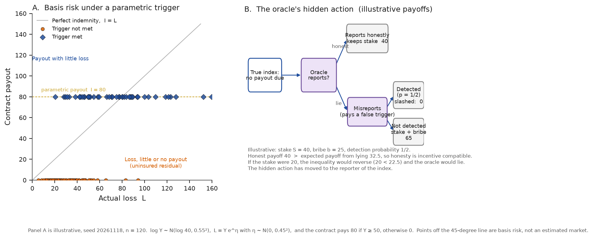

A play of the oracle game, by backward induction, runs as follows.

1. Consider the tempting branch, in which the true index does not warrant a payout. The oracle can report honestly and keep a stake of $40$, or can misreport, take a bribe of $25$, and face a probability $1/2$ of detection and slashing.
2. The expected payoff from lying is $32.5$. The honest payoff is $40$, so honesty is incentive compatible at this stake.
3. If the stake were $20$, the inequality would reverse ($20 < 22.5$), and the oracle would lie. The hidden action has not disappeared. It has moved to the reporter, and a residual-risk instrument, the slashable stake, is pointed at it.

### 7.4 Discretion versus code: a working mutual

A smart contract can pay a parametric trigger without a human claims adjuster. It cannot, without further machinery, decide a discretionary question such as whether a given exploit was in scope, whether a claimant took required precautions, or whether a halt in withdrawals at a custodian matches the wording of a cover. Those questions are hidden-action and contract-interpretation problems of a familiar kind.

Nexus Mutual is a working example of a **discretionary mutual** organized on a public chain. The description that follows is taken from the project's own documentation, fetched on 16 November 2026, and should be read as such, not as an audit. According to that documentation, members buy cover that is not the same as a traditional insurance policy. A member who suffers a material loss can submit a claim and go through a claims-assessment process. Designated assessors, organized in groups by product type, vote to accept or to deny a claim, and can record a rationale. The documentation states that assessors do not stake the mutual's token in order to vote, and that a cooldown period follows voting before an outcome is final. The same documentation reports that the mutual had paid more than USD 18.5 million in claims as of August 2026, after exploits, technical failures, and halted withdrawals on centralized custodians (Nexus Mutual, "Claims History" and "Assessments," docs.nexusmutual.io).

The design is interesting, in the language of this article, because it does not pretend that a compiler can replace claims assessment for non-parametric covers. It moves assessment to a designated group, with recorded votes. That is a governance choice about who holds the residual right to interpret the contract. It creates a new set of hidden-action and collusion problems at the assessor node, and it addresses them with group design, recorded rationales, and a cooldown, which are familiar kinds of monitor. Whether those instruments are adequate is an empirical question about this protocol, and it is not answered here.

Other on-chain insurance or "cover" arrangements exist and have failed, changed form, or remain thin. No census of them is attempted. The point is the structure, not a catalogue.

### 7.5 Basis risk as the price of removing moral hazard

The trade-off in Sections 7.3 and 7.4 can be stated as a rule, and the rule is older than any chain. If you write the contract on the individual loss, you must deal with hidden action in the loss and in the claim. If you write the contract on an index, you deal instead with basis risk, and with hidden action in the production of the index. Doherty and Richter (2002) is the insurance-theoretic statement. The on-chain case is an instance.

A designer who wants less moral hazard at the claimant, and also less basis risk, has to spend on information: better indices, more stations, individual-loss adjustment, or a hybrid in which a parametric layer pays quickly and a residual layer is adjusted. That is the same surplus calculation as in Section 5.5. There is no design in which hidden action, basis risk, and monitoring cost are all zero, unless the action is already costless or the loss is already identical to a public index.

### 7.6 What a hard-money collateral asset changes, and what it does not

If the pool's collateral is denominated in Bitcoin, or in another asset with a mechanically limited issuance, several things change, and several do not.

What can change: the inflation and discretionary-issuance risk of the collateral; the ease with which a third party can verify that the collateral is there, if it is held in a transparent output or contract; the censorship and seizure properties of settlement, which depend on the network and on the surrounding law; and the absence, in the native protocol, of a lender of last resort who can recapitalize the pool.

What does not change: the hidden-action problem of the insured; the hidden-type problem of selection; the oracle problem, if payment depends on a report; or basis risk, if payment depends on an index. A further, practical issue appears. Most of the losses people wish to insure (repairs, medical bills, legal liabilities, replacement of a house) are denominated in a local fiat currency, or in the price of a real good. A pool whose assets are held in Bitcoin then has a **denomination mismatch**. The cover can be written in Bitcoin, in which case the claimant bears exchange-rate risk relative to the real loss, which is another form of basis risk. Or the cover can be written in fiat terms, in which case the pool's collateral is volatile relative to its liabilities, and reserve adequacy has to be judged through that volatility. Neither choice is solved by the hardness of the asset. Hardness is a property of issuance, not a property of the correlation between the asset and the loss.

These remarks are arithmetic. They are not a forecast of Bitcoin's price, and they are not an argument against holding Bitcoin as collateral. They are an argument against treating the collateral asset as a substitute for the information structure of the contract.

### 7.7 Self-sustaining design and the absence of a bailout

A pool that cannot be recapitalized by a government or by an issuing authority has a simpler commitment problem on one side: there is, in the protocol itself, no bailout to anticipate, and therefore no collective moral hazard of the kind discussed in Section 8. That is a genuine difference in the game. It is purchased with a different risk, the risk that the pool is empty when the claim is due.

Self-sustaining design, in the sense of this article, means that the incentives of insured, insurer, assessors, and oracles are internalized in the contract and in the collateral, without a residual appeal to an unpriced backstop. Deductibles, coinsurance, experience rating, slashing, fully reserved wallets, and parametric triggers can all be parts of such a design. So can a rule that simply will not write cover for which the information structure is too rotten. What cannot be part of it is a quiet assumption that someone outside the contract will pay when the incentives fail. That assumption is the subject of the next section, in its older, off-chain forms.

## 8. Systemic moral hazard

The same constraint appears when the agent is a firm, a bank, or a government, and when the "insurance" is a guarantee, a relief program, or a safety rule that changes the cost of an accident. The treatment here is brief on purpose. The aim is to show that the grammar still applies, not to settle any of these literatures. The tone is intentionally dry. These are mechanism questions, and they remain mechanism questions when they are politically charged.

**Deposit insurance.** A guarantee of bank deposits at a fixed premium, if the premium does not track the risk the bank then takes, is a contract that leaves the bank's asset risk partly unpriced. Keeley (1990) argues that a fixed-rate deposit-insurance system creates a moral hazard of excessive risk taking, and is not viable without regulation; he links later problems in the United States in the early 1980s to a decline in bank charter values, which had previously given banks something to lose. The hidden action is on the bank's side. The residual-risk instruments are risk-sensitive premiums, capital requirements, monitoring, and, in the limit, the withdrawal of the guarantee. Each has a cost, including the possibility of runs if the guarantee is withdrawn or doubted.

**Too big to fail, and bailouts.** If a firm or a bank anticipates that it will be recapitalized in a joint failure, because it is too large or too connected to be allowed to fail, then leverage and maturity mismatch can become privately attractive even when they are jointly costly. Farhi and Tirole (2012) study this as **collective moral hazard**: private leverage choices are strategic complements when a systemic bailout is expected. The hidden, or at least not fully priced, action is the joint risk-taking. The ex post bailout is the indemnity. The grammar of Section 7.7 applies in reverse: an anticipated backstop is a contract, and it will be acted on.

Figure 11 makes that reverse grammar a game with unique backward induction. The payoffs, written (Bank, Social), are illustrative and are chosen so that the logic is unique; they are not estimated. Failure probabilities are $0.2$ if the bank is Safe and $0.6$ if it is Risky.

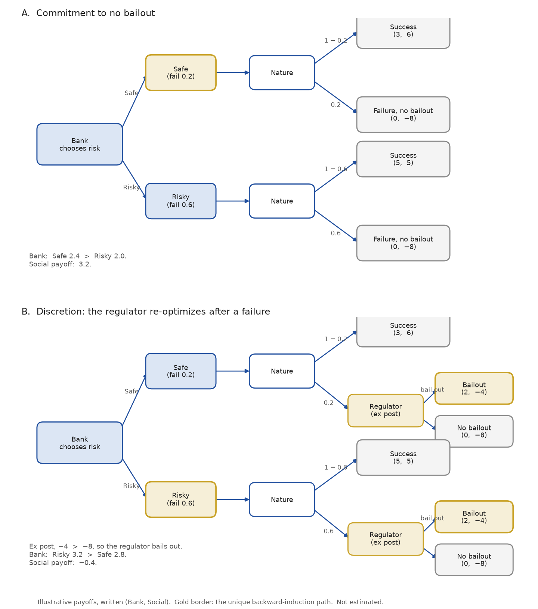

A play, by backward induction, runs as follows.

1. Suppose, first, that the regulator can commit to no bailout, as in panel A. The bank's expected payoff is then $2.4$ from Safe and $2.0$ from Risky, so the bank chooses Safe. Ex ante social payoff is $3.2$.
2. Now drop commitment, as in panel B. After a failure, the regulator's ex post payoff is $-4$ from a bailout and $-8$ from no bailout, so the regulator bails out.
3. Anticipating that, the bank's expected payoff is $2.8$ from Safe and $3.2$ from Risky, so the bank chooses Risky.
4. Ex ante social payoff is then $-0.4$, which is worse than under commitment. The indemnity that will be paid ex post is already, at the bank's action node, a contract.

**The Peltzman effect, or risk compensation.** Peltzman (1975) argued that automobile safety regulation can be offset, in part, by more aggressive driving. The regulation lowers the expected cost of an accident, and the hidden action, driving conduct, responds. This is not itself a result about an insurance contract. It is an ex ante behavioral response to a change in the cost of a bad outcome, and it belongs in the same family as ex ante moral hazard. The size of the offset is an empirical question, and it has been debated since the original paper. The mechanism does not depend on the debate about magnitude.

**Disaster insurance and public relief.** Flood and catastrophe insurance raise both the ordinary hidden-action problem (less mitigation when private losses are covered) and a related **charity hazard**, in which expected public relief crowds out private insurance (Raschky and Weck-Hannemann 2007). Browne and Hoyt (2000) study demand for cover under the United States National Flood Insurance Program, including the role of previous disaster relief. The graph has an extra node, public relief, with edges into the insurance decision and possibly into mitigation. An ex post relief program is, again, an indemnity, and it will be anticipated. Whether it should exist, and how it should be designed, is a political choice. The information-and-incentives consequences of the choice are not optional.

In all four cases, the useful questions are the same as in Section 3. What is hidden? What is the contractible event? Who bears residual risk? What signal is available, and what would it cost? The answers do not dictate a single policy, and this article does not offer one.

## 9. Ethics

"Moral hazard" is both a technical term and a phrase with a history. The history is not an embarrassment to be skipped. It is part of what the term does in public argument.

### 9.1 A positive term, and a normative residue

Baker (1996), in "On the Genealogy of Moral Hazard," traces the phrase through the insurance trade and into law and economics. In earlier usage, "moral" marked a hazard that arose from character and temptation. The economic usage, from Pauly (1968) onward, insists that the response to a lower out-of-pocket price is ordinary rationality, not perfidy. Baker's claim is that the later, apparently amoral, usage still does normative work: it can make certain forms of social responsibility look, by the very naming of the problem, like a mistake. One can accept or resist that claim. One cannot, after reading the 1968 exchange and Baker together, pretend that the word "moral" is inert.

Arrow (1968) is again relevant. He accepted the incentive analysis and still wanted room for professional norms and for self-imposed constraints. A complete treatment of the topic has both the price response and the possibility that not every response is a price response.

The rest of this section does not pick a single ethical theory. It sets out several views that actually disagree about insurance, and it locates the disagreement, where possible, in the same information structure used above. The point is to make the disagreement precise, not to declare a winner.

### 9.2 Several views, in one information structure

**A welfarist, or expected-utility, view** asks whether a contract raises total surplus, counting the gains from risk sharing and the losses from distorted action, and counting distribution only insofar as it is already represented in a social welfare function. Pauly, Baily, Chetty, and the standard principal-agent papers are in this family when they are read normatively. On this view, a deductible is justified when the incentive gain, plus any saving in loading, outweighs the risk-sharing loss. Randomization of coverage, as in RAND, is valuable because it identifies a welfare-relevant elasticity. The Hirshleifer effect is a warning that some information has a social value below its private value.

**A view from actuarial fairness** says that each insured should pay, as nearly as possible, the expected cost of their own risk, given the information that is permissible to use. Cross-subsidy among types is then a problem, not a goal. Screening and classification are, on this view, required rather than suspect, except where the information is statistically irrelevant. Residual risk left with the agent is still justified by incentives, as in the welfarist view. The two views part company when a signal about type is available and would, if used, raise premiums for the unlucky.

**A solidarity, or mutual-aid, view** says that insurance is, among other things, a way of sharing luck that no one chose, and that a community may refuse to let certain kinds of luck, illness, or genetics, or a birth lottery, be fully priced into individual premiums. Community rating is the extreme instrument. On this view, some edges from $\theta$ to the premium should be forbidden even if they are informative. GINA can be read as a limited adoption of this view for a class of health-coverage and employment decisions in the United States, or as a Hirshleifer-protecting rule, or as both.

**A rights, or deontological, view** starts from claims the parties have, including claims to privacy, to bodily information, and to be free of certain kinds of surveillance, that are not necessarily reducible to willingness to pay. Telematic monitoring and genetic testing are the sharp cases. Even if a signal is informative about $a$ or about $\theta$, and even if the informativeness principle says the contract would use it, a rights view may say the signal may not be collected, or may be collected only with a refusal option that is genuinely open. The participation constraint in the standard model can represent a refusal, but only by translating the right into a utility cost, which is exactly the translation this view resists.

**A contractualist, or freedom-of-contract, view** says that parties should be free to write the contracts they wish, including contracts that use a signal and contracts that refuse a signal, so long as the usual conditions of consent and non-fraud hold. On this view, the main ethical failure is coercion or concealment, not classification as such. A transparent pricing function, in the sense of Section 6.4, is attractive here because it makes the bargain legible. This view will often agree with actuarial fairness about the use of type information, and will disagree with solidarity about community rating, unless the community rating is itself voluntarily chosen by a mutual.

**A view that takes professional and civic norms as primitive**, closer to Arrow (1968), says that some agents, physicians, claims assessors, oracles, directors, are under standards of conduct that are not exhausted by the incentive scheme. The model in Section 3 can still describe what happens if those standards fail. It should not be mistaken for a complete description of what the standards are for.

These views conflict, and they conflict at named places in the graph: at the edges from $\theta$ to the premium, at the edges from $s$ to the premium when $s$ is intimate or involuntary, and at the question whether an ex post public indemnity, a relief program or a bailout, should exist as a node at all. A complete conceptual presentation has to leave the conflict visible. It does not have to pretend that a more refined elasticity will settle it.

### 9.3 Fairness in classification, privacy, and disclosure

Three practical questions follow, and they should be asked in the language already in use.

Which observed parents may a premium depend on? Age, past claims, miles driven, genetics, wealth, neighborhood, and credit are all, in various markets, actual or proposed parents of $\pi$. Statistical informativeness is a welfarist and actuarial reason to use a parent. Solidarity and rights views may reject some of those reasons even when the statistics are good. Transparency of the function at least forces the parent to be named.

When may a party require a signal, and when may the other party refuse it? A voluntary telematic discount, with a genuine unmonitored alternative, is a different contract from a mandate. GINA, in covered health-insurance and employment settings, is a refusal right (and a prohibition on the other party's use) for a class of signals. The single-person value of information and the Hirshleifer effect will often disagree about whether disclosure is a gain.

When is withholding information a wrong, and when is it the condition of a market? An insured who conceals a known, already-realized loss is in the territory of fraud, which is not the same as hiding a type or an action the contract did not ask to observe. An insurer who conceals the parents of a premium is failing the first kind of transparency. A society that withholds a class of type-information from a pricing function may be protecting a risk-sharing market, or may be requiring a cross-subsidy, or both. The graph does not answer which of those is justified. It prevents them from being described as the same act.

## 10. Overlay, and open questions

### 10.1 One table for the whole article

Every section of this article has been a variation on four questions. What is hidden? What event is the contract written on? Who is left holding residual risk? What would a further signal be worth, and to whom?

| Setting | What is hidden | Contractible event | Residual risk sits with | A further signal is | Characteristic price of the design |
| --- | --- | --- | --- | --- | --- |
| First-best insurance | Nothing that matters | The action and the loss | The insurer, if risk neutral | Unnecessary | The ordinary loading, if any |
| Second-best indemnity insurance | Prevention $a$, or utilization $m$ | The claim $k$, perhaps a coarse $s$ | The insured, through $d$, $\alpha$, or bonus-malus | A monitor of $a$ or of $k$, valued by the informativeness principle | Agency cost: less smoothing |
| Screening or signaling market | Type $\theta$ | The chosen menu item, or the signal | Types, through the menu or the cost of the signal | A better screen, or a cheaper signal | Possible missing markets; cream-skimming |
| Public information before trade | Nothing, once the state is revealed | Too late | The unlucky, at nearly actuarial-in-hindsight prices | The revelation itself can have negative social value (Hirshleifer) | Destruction of ex ante risk sharing |
| Parametric or index cover | The individual loss, largely set aside | An index, via an oracle | The claimant, as basis risk; the oracle, if slashed | A better index, or a hybrid residual layer (Doherty and Richter 2002) | Basis risk; oracle hidden action |
| On-chain reserved pool | Still $a$ and $\theta$ | Whatever the contract writes on, plus visible collateral | The pool's residual, which cannot be quietly backstopped on-chain | Auditable reserves (transparency of assets, not of $a$) | Denomination mismatch, if the loss is in another unit |
| Deposit insurance, bailouts, disaster relief | The bank's, firm's, or property owner's risk-taking or mitigation | The official trigger for the guarantee or the relief | Taxpayers, or later claimants, if the trigger is anticipated | Supervision, risk-based premia, or a credible refusal to pay | Collective moral hazard, if the backstop is priced at zero |

The overlay is the claim that these rows are not different subjects. They are different fillings of the same columns. A proposal, whether a new deductible, a telematic feed, a genetic-privacy rule, a Bitcoin reserve, or a bailout, can be scored by filling the columns honestly. If a proposal claims to remove a hidden action and does not say where residual risk now sits, or where a new hidden action has been moved, the proposal is incomplete.

### 10.2 Open questions

Several questions seem to me genuinely open, rather than merely unreviewed for this draft.

How far can a graphical model be taken as a practical identification strategy in insurance data, beyond the already-understood contrast between random assignment and chosen coverage? A fully specified influence diagram, with some nodes hidden, is a structural assumption. It could, in principle, organize a research program that states, for each data set, which paths are cut and which are not. It has not yet done so in any systematic way that I can cite.

What is the empirically relevant size of oracle manipulation, and of assessor failure, in working on-chain mutuals? The question is answerable in principle from public ledgers and from recorded votes. It is not answered here, and public-relations documentation is not a substitute for that answer.

How should a privacy cost, or a right to refuse a signal, be brought into the informativeness principle without simply inventing a utility penalty that begs the ethical question? This is a problem for anyone who wants the model of Section 3 and the views of Section 9 to talk to each other, rather than to occupy adjacent sections.

In the Baily-Chetty family of formulas, how much of an observed elasticity is incentive, how much is liquidity, and how much, in health rather than in unemployment, is useful care that a purely fiscal objective would under-weight? The RAND and Oregon results show that use moves. They do not, by themselves, say how much of the movement is waste.

Finally, when a type-signal becomes cheaper, as genetic information and other predictors have, societies will keep having to choose between the actuarial use of the signal, a legal wall of the GINA kind, and some intermediate tax-and-transfer scheme. That is not a question a hidden-action model can close. It is a question the model can keep from being mis-described.

What this article has tried to make harder is a weaker claim: that moral hazard is a vague moral failing, or that a new settlement technology has repealed it, or that more information is always a social gain. It is a constraint on what can be contracted, it has a measurable cost in residual risk, and it reappears wherever the contractible event is moved.

## References

Entries are listed once, in alphabetical order. Where an original journal DOI was not found in Crossref, that fact is stated and a stable link is given. Reprint DOIs are labeled as reprints.

Akerlof, George A. 1970. "The Market for 'Lemons': Quality Uncertainty and the Market Mechanism." *Quarterly Journal of Economics* 84(3): 488-500. [doi:10.2307/1879431](https://doi.org/10.2307/1879431)

Aron-Dine, Aviva, Liran Einav, and Amy Finkelstein. 2013. "The RAND Health Insurance Experiment, Three Decades Later." *Journal of Economic Perspectives* 27(1): 197-222. [doi:10.1257/jep.27.1.197](https://doi.org/10.1257/jep.27.1.197)

Arrow, Kenneth J. 1963. "Uncertainty and the Welfare Economics of Medical Care." *American Economic Review* 53(5): 941-973. No original journal DOI found. Official AEA PDF: [https://assets.aeaweb.org/asset-server/files/9442.pdf](https://assets.aeaweb.org/asset-server/files/9442.pdf)

Arrow, Kenneth J. 1968. "The Economics of Moral Hazard: Further Comment." *American Economic Review* 58(3, Part 1): 537-539. No original journal DOI found. A 1982 book-reprint DOI is [10.1017/cbo9780511528248.010](https://doi.org/10.1017/cbo9780511528248.010)

Baily, Martin Neil. 1978. "Some Aspects of Optimal Unemployment Insurance." *Journal of Public Economics* 10(3): 379-402. [doi:10.1016/0047-2727(78)90053-1](https://doi.org/10.1016/0047-2727(78)90053-1)

Baker, Tom. 1996. "On the Genealogy of Moral Hazard." *Texas Law Review* 75(2): 237-292. Penn Carey Law repository: [https://scholarship.law.upenn.edu/faculty_scholarship/872](https://scholarship.law.upenn.edu/faculty_scholarship/872)

Blackwell, David. 1953. "Equivalent Comparisons of Experiments." *Annals of Mathematical Statistics* 24(2): 265-272. [doi:10.1214/aoms/1177729032](https://doi.org/10.1214/aoms/1177729032)

Browne, Mark J., and Robert E. Hoyt. 2000. "The Demand for Flood Insurance: Empirical Evidence." *Journal of Risk and Uncertainty* 20(3): 291-306. [doi:10.1023/A:1007823631497](https://doi.org/10.1023/A:1007823631497)

Chetty, Raj. 2006. "A General Formula for the Optimal Level of Social Insurance." *Journal of Public Economics* 90(10-11): 1879-1901. [doi:10.1016/j.jpubeco.2006.01.004](https://doi.org/10.1016/j.jpubeco.2006.01.004)

Chetty, Raj. 2008. "Moral Hazard versus Liquidity and Optimal Unemployment Insurance." *Journal of Political Economy* 116(2): 173-234. [doi:10.1086/588585](https://doi.org/10.1086/588585)

Chiappori, Pierre-André, and Bernard Salanié. 2000. "Testing for Asymmetric Information in Insurance Markets." *Journal of Political Economy* 108(1): 56-78. [doi:10.1086/262111](https://doi.org/10.1086/262111)

Cummins, J. David, David Lalonde, and Richard D. Phillips. 2004. "The Basis Risk of Catastrophic-Loss Index Securities." *Journal of Financial Economics* 71(1): 77-111. [doi:10.1016/S0304-405X(03)00172-7](https://doi.org/10.1016/S0304-405X(03)00172-7)

Doherty, Neil A., and Andreas Richter. 2002. "Moral Hazard, Basis Risk, and Gap Insurance." *Journal of Risk and Insurance* 69(1): 9-24. [doi:10.1111/1539-6975.00002](https://doi.org/10.1111/1539-6975.00002)

Edlin, Aaron S. 1999. "Per-Mile Premiums for Auto Insurance." NBER Working Paper 6934. [doi:10.3386/w6934](https://doi.org/10.3386/w6934). This is a working paper, not a journal article.

Ehrlich, Isaac, and Gary S. Becker. 1972. "Market Insurance, Self-Insurance, and Self-Protection." *Journal of Political Economy* 80(4): 623-648. [doi:10.1086/259916](https://doi.org/10.1086/259916)

Einav, Liran, Amy Finkelstein, and Mark R. Cullen. 2010. "Estimating Welfare in Insurance Markets Using Variation in Prices." *Quarterly Journal of Economics* 125(3): 877-921. [doi:10.1162/qjec.2010.125.3.877](https://doi.org/10.1162/qjec.2010.125.3.877)

Einav, Liran, Amy Finkelstein, Stephen P. Ryan, Paul Schrimpf, and Mark R. Cullen. 2013. "Selection on Moral Hazard in Health Insurance." *American Economic Review* 103(1): 178-219. [doi:10.1257/aer.103.1.178](https://doi.org/10.1257/aer.103.1.178)

Farhi, Emmanuel, and Jean Tirole. 2012. "Collective Moral Hazard, Maturity Mismatch, and Systemic Bailouts." *American Economic Review* 102(1): 60-93. [doi:10.1257/aer.102.1.60](https://doi.org/10.1257/aer.102.1.60)

Finkelstein, Amy, Sarah Taubman, Bill Wright, Mira Bernstein, Jonathan Gruber, Joseph P. Newhouse, Heidi Allen, Katherine Baicker, and the Oregon Health Study Group. 2012. "The Oregon Health Insurance Experiment: Evidence from the First Year." *Quarterly Journal of Economics* 127(3): 1057-1106. [doi:10.1093/qje/qjs020](https://doi.org/10.1093/qje/qjs020)

Grossman, Sanford J., and Oliver D. Hart. 1983. "An Analysis of the Principal-Agent Problem." *Econometrica* 51(1): 7-46. [doi:10.2307/1912246](https://doi.org/10.2307/1912246)

Hirshleifer, Jack. 1971. "The Private and Social Value of Information and the Reward to Inventive Activity." *American Economic Review* 61(4): 561-574. No original journal DOI confirmed in Crossref for this draft. JSTOR stable record: [https://www.jstor.org/stable/1811850](https://www.jstor.org/stable/1811850). RePEc: [https://ideas.repec.org/a/aea/aecrev/v61y1971i4p561-74.html](https://ideas.repec.org/a/aea/aecrev/v61y1971i4p561-74.html)

Holmstrom, Bengt. 1979. "Moral Hazard and Observability." *Bell Journal of Economics* 10(1): 74-91. [doi:10.2307/3003320](https://doi.org/10.2307/3003320)

Holmstrom, Bengt, and Paul Milgrom. 1987. "Aggregation and Linearity in the Provision of Intertemporal Incentives." *Econometrica* 55(2): 303-328. [doi:10.2307/1913238](https://doi.org/10.2307/1913238)

Holmstrom, Bengt, and Paul Milgrom. 1991. "Multitask Principal-Agent Analyses: Incentive Contracts, Asset Ownership, and Job Design." *Journal of Law, Economics, and Organization* 7(special issue): 24-52. [doi:10.1093/jleo/7.special_issue.24](https://doi.org/10.1093/jleo/7.special_issue.24)

Howard, Ronald A. 1966. "Information Value Theory." *IEEE Transactions on Systems Science and Cybernetics* 2(1): 22-26. [doi:10.1109/TSSC.1966.300074](https://doi.org/10.1109/TSSC.1966.300074)

Howard, Ronald A., and James E. Matheson. 2005. "Influence Diagrams." *Decision Analysis* 2(3): 127-143. [doi:10.1287/deca.1050.0020](https://doi.org/10.1287/deca.1050.0020). Originally circulated in 1981.

Jewitt, Ian. 1988. "Justifying the First-Order Approach to Principal-Agent Problems." *Econometrica* 56(5): 1177-1190. [doi:10.2307/1911363](https://doi.org/10.2307/1911363)

Keeley, Michael C. 1990. "Deposit Insurance, Risk, and Market Power in Banking." *American Economic Review* 80(5): 1183-1200. No original journal DOI found. RePEc: [https://ideas.repec.org/a/aea/aecrev/v80y1990i5p1183-1200.html](https://ideas.repec.org/a/aea/aecrev/v80y1990i5p1183-1200.html)

Manning, Willard G., Joseph P. Newhouse, Naihua Duan, Emmett B. Keeler, Arleen Leibowitz, and M. Susan Marquis. 1987. "Health Insurance and the Demand for Medical Care: Evidence from a Randomized Experiment." *American Economic Review* 77(3): 251-277. No original journal DOI found. RePEc: [https://ideas.repec.org/a/aea/aecrev/v77y1987i3p251-77.html](https://ideas.repec.org/a/aea/aecrev/v77y1987i3p251-77.html)

Mirrlees, James A. 1976. "The Optimal Structure of Incentives and Authority within an Organization." *Bell Journal of Economics* 7(1): 105-131. [doi:10.2307/3003192](https://doi.org/10.2307/3003192)

Mirrlees, James A. 1999. "The Theory of Moral Hazard and Unobservable Behaviour: Part I." *Review of Economic Studies* 66(1): 3-21. [doi:10.1111/1467-937X.00075](https://doi.org/10.1111/1467-937X.00075). A 1975 manuscript, published later.

Mossin, Jan. 1968. "Aspects of Rational Insurance Purchasing." *Journal of Political Economy* 76(4, Part 1): 553-568. [doi:10.1086/259427](https://doi.org/10.1086/259427)

Nexus Mutual. 2026. "Claims History" and "Assessments." Protocol documentation, [https://docs.nexusmutual.io/overview/claims-history/](https://docs.nexusmutual.io/overview/claims-history/) and [https://docs.nexusmutual.io/developers/contracts/Assessments/](https://docs.nexusmutual.io/developers/contracts/Assessments/). Fetched 16 November 2026. Project documentation, not a peer-reviewed source. The claims-paid figure quoted in the text is the project's own reported figure as of August 2026.

Pauly, Mark V. 1968. "The Economics of Moral Hazard: Comment." *American Economic Review* 58(3, Part 1): 531-537. No original journal DOI found. JSTOR sici link: [http://links.jstor.org/sici?sici=0002-8282%28196806%2958%3A3%3C531%3ATEOMHC%3E2.0.CO%3B2-A](http://links.jstor.org/sici?sici=0002-8282%28196806%2958%3A3%3C531%3ATEOMHC%3E2.0.CO%3B2-A). The quotation in Section 2.2 is from p. 535 of that article, as printed in a copy of the JSTOR record.

Pearl, Judea. 1995. "Causal Diagrams for Empirical Research." *Biometrika* 82(4): 669-688. [doi:10.1093/biomet/82.4.669](https://doi.org/10.1093/biomet/82.4.669)

Peltzman, Sam. 1975. "The Effects of Automobile Safety Regulation." *Journal of Political Economy* 83(4): 677-725. [doi:10.1086/260352](https://doi.org/10.1086/260352)

Pratt, John W. 1964. "Risk Aversion in the Small and in the Large." *Econometrica* 32(1/2): 122-136. [doi:10.2307/1913738](https://doi.org/10.2307/1913738)

Raschky, Paul A., and Hannelore Weck-Hannemann. 2007. "Charity Hazard: A Real Hazard to Natural Disaster Insurance?" *Environmental Hazards* 7(4): 321-329. [doi:10.1016/j.envhaz.2007.09.002](https://doi.org/10.1016/j.envhaz.2007.09.002)

Raviv, Artur. 1979. "The Design of an Optimal Insurance Policy." *American Economic Review* 69(1): 84-96. No original journal DOI found. RePEc: [https://ideas.repec.org/a/aea/aecrev/v69y1979i1p84-96.html](https://ideas.repec.org/a/aea/aecrev/v69y1979i1p84-96.html)

Rogerson, William P. 1985. "The First-Order Approach to Principal-Agent Problems." *Econometrica* 53(6): 1357-1367. [doi:10.2307/1913212](https://doi.org/10.2307/1913212)

Rothschild, Michael, and Joseph Stiglitz. 1976. "Equilibrium in Competitive Insurance Markets: An Essay on the Economics of Imperfect Information." *Quarterly Journal of Economics* 90(4): 629-649. [doi:10.2307/1885326](https://doi.org/10.2307/1885326)

Shavell, Steven. 1979. "On Moral Hazard and Insurance." *Quarterly Journal of Economics* 93(4): 541-562. [doi:10.2307/1884469](https://doi.org/10.2307/1884469)

Spence, Michael. 1973. "Job Market Signaling." *Quarterly Journal of Economics* 87(3): 355-374. [doi:10.2307/1882010](https://doi.org/10.2307/1882010)

Spence, Michael, and Richard Zeckhauser. 1971. "Insurance, Information, and Individual Action." *American Economic Review* 61(2): 380-387. No original journal DOI found. RePEc: [https://ideas.repec.org/a/aea/aecrev/v61y1971i2p380-87.html](https://ideas.repec.org/a/aea/aecrev/v61y1971i2p380-87.html)

United States Congress. 2008. Genetic Information Nondiscrimination Act of 2008, Public Law 110-233, 122 Stat. 881. [https://www.govinfo.gov/content/pkg/PLAW-110publ233/html/PLAW-110publ233.htm](https://www.govinfo.gov/content/pkg/PLAW-110publ233/html/PLAW-110publ233.htm)

Zeckhauser, Richard. 1970. "Medical Insurance: A Case Study of the Tradeoff between Risk Spreading and Appropriate Incentives." *Journal of Economic Theory* 2(1): 10-26. [doi:10.1016/0022-0531(70)90010-4](https://doi.org/10.1016/0022-0531(70)90010-4)

Zweifel, Peter, and Willard G. Manning. 2000. "Moral Hazard and Consumer Incentives in Health Care." In *Handbook of Health Economics*, vol. 1, ch. 8, 409-459, edited by A. J. Culyer and J. P. Newhouse. [doi:10.1016/S1574-0064(00)80167-5](https://doi.org/10.1016/S1574-0064(00)80167-5)

