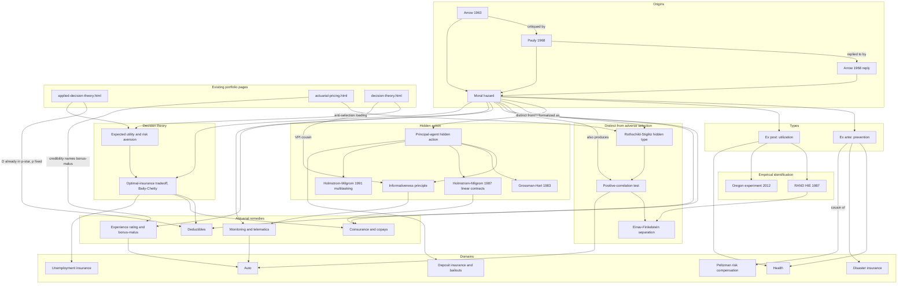

# Concept map: moral hazard

Draft only. This is a readable companion to `concept-map.json`. Citations were checked on 16 November 2026 against publisher pages, Crossref, RePEc, or official PDFs. Where an original journal DOI could not be found, that is marked in the bibliography at the end.

The map has eight branches: origins, types, hidden-action models, the distinction from adverse selection, empirical identification, actuarial remedies, domains, and the decision-theory tradeoff. Three portfolio hooks sit at the bottom.

## How to read the mermaid diagram

Boxes are concepts or models. Rounded boxes are empirical findings. Stadium shapes are remedies. Cylinders are domains. Edges are labeled with the relation.

## Branch notes

### Origins

Arrow (1963) compared medical care with the competitive welfare benchmark and traced many of its special features to uncertainty in illness and in treatment. He argued that the welfare case for insurance is strong, and that missing insurance markets are a form of market failure.

Pauly (1968) replied that if demand is price-elastic, insurance that cuts the out-of-pocket price will raise use. Full coverage need not be optimal. The absence of some markets need not mean that government should supply the missing cover. He treated the response as ordinary price theory, not as moral failure.

Arrow (1968) accepted that complete insurance is no longer optimal when the method of insurance itself influences demand, and likened the effect to an excise tax. He also argued that Pauly's exclusive emphasis on market incentives overlooked professional and social norms that can limit the response.

### Ex ante versus ex post

Ex ante moral hazard is a change in prevention, or in other actions taken before a loss, that shifts the probability of the loss. Ehrlich and Becker (1972) separate market insurance, self-insurance (reducing loss size), and self-protection (reducing loss probability).

Ex post moral hazard is a change in use or in loss size after a loss or illness has occurred. In health insurance this is the rise in medical-care use when the out-of-pocket price falls. Zweifel and Manning (2000, Handbook of Health Economics, ch. 8) report that theory does not unambiguously predict a fall in prevention, that evidence on ex ante effects in health care is limited, and that static ex post effects are the case with the stronger theory and the stronger evidence. They also flag a possible dynamic form, a bias toward new and costlier technology.

### Hidden action and principal-agent models

The general theory is a principal who writes a contract on an observed outcome, and an agent who chooses an unobserved action that shifts the distribution of that outcome. The tension is risk sharing versus incentives.

Holmström (1979) gives the informativeness principle: a signal other than the outcome belongs in the contract if and only if it carries information about the hidden action that the outcome does not already contain. This is the contract-design cousin of VPI on `decision-theory.html`.

Grossman and Hart (1983) replace the first-order approach, which is not generally valid, with a two-stage method: first find the cheapest contract that implements a given action, then choose the action.

Holmström and Milgrom (1987) give conditions, in continuous time with exponential utility and Brownian information, under which the optimal scheme is linear in aggregated outcomes. That result is the usual formal reason to study coinsurance as a simple linear share. Holmström and Milgrom (1991) show that when some tasks are harder to measure than others, strong incentives on the measurable task can pull effort away from the unmeasurable one. Incentive intensity should then fall.

### Distinction from adverse selection

Adverse selection is hidden type, not hidden action. Rothschild and Stiglitz (1976) show that a competitive market with hidden types may have a separating equilibrium in which higher-risk agents buy more coverage, or may have no equilibrium. The actuarial page already names this problem as an "anti-selection" margin inside the loading. It does not model it.

A positive correlation between coverage and claims, after conditioning on observables, is evidence of asymmetric information (Chiappori and Salanié 2000). It does not, by itself, say whether the cause is adverse selection, moral hazard, or both. In their French automobile sample the authors did not reject the null of no residual correlation. Einav, Finkelstein, and Cullen (2010) use price variation to trace demand and average-cost curves and to measure the welfare cost of selection. Einav, Finkelstein, Ryan, Schrimpf, and Cullen (2013) estimate selection on moral hazard: people who choose more coverage also have a larger behavioral response. Both Einav-Finkelstein microdata files are confidential employer data, not public.

### Empirical work

The RAND Health Insurance Experiment assigned families at random to plans with different cost sharing, which identifies a price response without confounding by who chose which plan. Manning, Newhouse, Duan, Keeler, Leibowitz, and Marquis (1987) report that a catastrophic plan reduces expenditures 31 percent relative to a zero out-of-pocket price, and that the price elasticity is approximately 0.2 in absolute value. Those two figures are taken from the paper's abstract as recorded on RePEc, not from a new run of the microdata. Aron-Dine, Einav, and Finkelstein (2013) review the design and later re-analyses. Public-use files are ICPSR 6439, DOI `10.3886/ICPSR06439.v1`. The ICPSR study page, fetched 16 November 2026, says access does not require affiliation with a member institution. A free ICPSR account is still typically required. RAND's older instructions page still mentions possible fees for non-members. Access terms should be re-checked at download time.

The Oregon Health Insurance Experiment used a 2008 lottery for a limited number of Medicaid slots. Finkelstein, Taubman, Wright, Bernstein, Gruber, Newhouse, Allen, Baicker, and the Oregon Health Study Group (2012) study the first year. Public-use data and replication code are on the NBER Oregon page, under click-through terms that bar identification of subjects and commercial use, and that require citation of the data.

### Actuarial remedies

These are the self-sustaining contract devices, not transfers that leave incentives untouched.

Deductibles. The insured pays the first dollars of a loss. Mossin (1968) shows that when insurance is loaded above the actuarial premium, a positive deductible is optimal for a risk-averse buyer. Raviv (1979) studies the broader design of an optimal policy. The applied page already has the deductible as residual cost \(D\) in \(p^{\ast}=C/(L-D)\), with \(p\) held fixed.

Coinsurance and copays. The insured pays a fraction of the loss, or a fixed amount per use. Zeckhauser (1970) is the classic analysis of risk spreading versus incentives in medical insurance. The applied page lists a copay as one reading of \(D\), and does not mention coinsurance by name.

Experience rating and bonus-malus. Future premiums depend on past claims. The actuarial page already names these as applications of Bühlmann credibility. They are also incentive devices: the insured internalizes part of the future cost of a claim. Shavell (1979) analyzes observation of care under moral hazard.

Monitoring and telematics. If a signal of hidden action can be observed, the informativeness principle says it belongs in the contract. Edlin (1999, NBER working paper 6934) analyzes per-mile premiums as a way to price the marginal mile. Usage-based and telematic insurance is the later commercial form of the same idea.

### Domains

Health is the setting of Arrow, Pauly, Zeckhauser, RAND, Oregon, and Einav-Finkelstein. Auto is the setting of bonus-malus, telematics, and the Chiappori-Salanié test. Deposit insurance and bailouts are a guarantee that can dull private risk control (Keeley 1990 on fixed-rate deposit insurance and charter values; Farhi and Tirole 2012 on collective moral hazard and systemic bailouts). Unemployment insurance is where the Baily-Chetty formula is usually stated (Baily 1978; Chetty 2006, 2008). Disaster insurance adds a related "charity hazard," in which expected public relief can crowd out private cover (Raschky and Weck-Hannemann 2007; Browne and Hoyt 2000 on flood-insurance demand). The Peltzman (1975) offset hypothesis is risk compensation in driving, a cousin of ex ante moral hazard, not a result about insurance contracts.

Any write-up of deposit insurance, bailouts, or unemployment insurance should stay with mechanisms and evidence, and should not turn into a political argument.

### Decision-theory framing

The buyer wants insurance because of risk aversion (Pratt 1964). The applied insurance thread already uses the approximation \(\tfrac12 A(W)\,\mathrm{Var}(\text{loss})\) for the risk premium, without naming Arrow or Pratt. The actuarial page uses an insurer risk-aversion coefficient in the exponential premium principle.

Insurance has value because it smooths consumption, and a cost because it changes behavior. At an optimum those two forces balance. Chetty (2006), equation (8), equates the gap in marginal utilities between the unemployed and employed states to the elasticity term \((b/D)(dD/db)\). The first-order approximation, ignoring third-order terms in utility, is Baily's inverse-elasticity rule. A prudence correction appears if those terms are kept. This file does not restate a compact typographic form of the approximation, because PDF text extraction garbled some of the symbols. Any formula on a public page should be copied from the typeset papers.

## Bibliography

Entries without an original journal DOI are marked. Reprint DOIs are labeled as reprints.

- Arrow, Kenneth J. 1963. "Uncertainty and the Welfare Economics of Medical Care." *American Economic Review* 53(5): 941-973. No original journal DOI found. Official AEA PDF: https://assets.aeaweb.org/asset-server/files/9442.pdf
- Arrow, Kenneth J. 1968. "The Economics of Moral Hazard: Further Comment." *American Economic Review* 58(3, Part 1): 537-539. No original journal DOI found. A 1982 book-reprint DOI is [10.1017/cbo9780511528248.010](https://doi.org/10.1017/cbo9780511528248.010)
- Aron-Dine, Aviva, Liran Einav, and Amy Finkelstein. 2013. "The RAND Health Insurance Experiment, Three Decades Later." *Journal of Economic Perspectives* 27(1): 197-222. [doi:10.1257/jep.27.1.197](https://doi.org/10.1257/jep.27.1.197)
- Baily, Martin Neil. 1978. "Some Aspects of Optimal Unemployment Insurance." *Journal of Public Economics* 10(3): 379-402. [doi:10.1016/0047-2727(78)90053-1](https://doi.org/10.1016/0047-2727(78)90053-1)
- Browne, Mark J., and Robert E. Hoyt. 2000. "The Demand for Flood Insurance: Empirical Evidence." *Journal of Risk and Uncertainty* 20(3): 291-306. [doi:10.1023/A:1007823631497](https://doi.org/10.1023/A:1007823631497)
- Chetty, Raj. 2006. "A General Formula for the Optimal Level of Social Insurance." *Journal of Public Economics* 90(10-11): 1879-1901. [doi:10.1016/j.jpubeco.2006.01.004](https://doi.org/10.1016/j.jpubeco.2006.01.004)
- Chetty, Raj. 2008. "Moral Hazard versus Liquidity and Optimal Unemployment Insurance." *Journal of Political Economy* 116(2): 173-234. [doi:10.1086/588585](https://doi.org/10.1086/588585)
- Chiappori, Pierre-André, and Bernard Salanié. 2000. "Testing for Asymmetric Information in Insurance Markets." *Journal of Political Economy* 108(1): 56-78. [doi:10.1086/262111](https://doi.org/10.1086/262111)
- Edlin, Aaron S. 1999. "Per-Mile Premiums for Auto Insurance." NBER Working Paper 6934. [doi:10.3386/w6934](https://doi.org/10.3386/w6934). This is a working paper, not a journal article.
- Ehrlich, Isaac, and Gary S. Becker. 1972. "Market Insurance, Self-Insurance, and Self-Protection." *Journal of Political Economy* 80(4): 623-648. [doi:10.1086/259916](https://doi.org/10.1086/259916)
- Einav, Liran, Amy Finkelstein, and Mark R. Cullen. 2010. "Estimating Welfare in Insurance Markets Using Variation in Prices." *Quarterly Journal of Economics* 125(3): 877-921. [doi:10.1162/qjec.2010.125.3.877](https://doi.org/10.1162/qjec.2010.125.3.877)
- Einav, Liran, Amy Finkelstein, Stephen P. Ryan, Paul Schrimpf, and Mark R. Cullen. 2013. "Selection on Moral Hazard in Health Insurance." *American Economic Review* 103(1): 178-219. [doi:10.1257/aer.103.1.178](https://doi.org/10.1257/aer.103.1.178)
- Farhi, Emmanuel, and Jean Tirole. 2012. "Collective Moral Hazard, Maturity Mismatch, and Systemic Bailouts." *American Economic Review* 102(1): 60-93. [doi:10.1257/aer.102.1.60](https://doi.org/10.1257/aer.102.1.60)
- Finkelstein, Amy, Sarah Taubman, Bill Wright, Mira Bernstein, Jonathan Gruber, Joseph P. Newhouse, Heidi Allen, Katherine Baicker, and the Oregon Health Study Group. 2012. "The Oregon Health Insurance Experiment: Evidence from the First Year." *Quarterly Journal of Economics* 127(3): 1057-1106. [doi:10.1093/qje/qjs020](https://doi.org/10.1093/qje/qjs020)
- Grossman, Sanford J., and Oliver D. Hart. 1983. "An Analysis of the Principal-Agent Problem." *Econometrica* 51(1): 7-46. [doi:10.2307/1912246](https://doi.org/10.2307/1912246)
- Holmstrom, Bengt. 1979. "Moral Hazard and Observability." *Bell Journal of Economics* 10(1): 74-91. [doi:10.2307/3003320](https://doi.org/10.2307/3003320)
- Holmstrom, Bengt, and Paul Milgrom. 1987. "Aggregation and Linearity in the Provision of Intertemporal Incentives." *Econometrica* 55(2): 303-328. [doi:10.2307/1913238](https://doi.org/10.2307/1913238)
- Holmstrom, Bengt, and Paul Milgrom. 1991. "Multitask Principal-Agent Analyses: Incentive Contracts, Asset Ownership, and Job Design." *Journal of Law, Economics, and Organization* 7(special issue): 24-52. [doi:10.1093/jleo/7.special_issue.24](https://doi.org/10.1093/jleo/7.special_issue.24)
- Keeley, Michael C. 1990. "Deposit Insurance, Risk, and Market Power in Banking." *American Economic Review* 80(5): 1183-1200. No original journal DOI found. [RePEc record](https://ideas.repec.org/a/aea/aecrev/v80y1990i5p1183-1200.html)
- Manning, Willard G., Joseph P. Newhouse, Naihua Duan, Emmett B. Keeler, Arleen Leibowitz, and M. Susan Marquis. 1987. "Health Insurance and the Demand for Medical Care: Evidence from a Randomized Experiment." *American Economic Review* 77(3): 251-277. No original journal DOI found. [RePEc record](https://ideas.repec.org/a/aea/aecrev/v77y1987i3p251-77.html)
- Mossin, Jan. 1968. "Aspects of Rational Insurance Purchasing." *Journal of Political Economy* 76(4, Part 1): 553-568. [doi:10.1086/259427](https://doi.org/10.1086/259427)
- Pauly, Mark V. 1968. "The Economics of Moral Hazard: Comment." *American Economic Review* 58(3, Part 1): 531-537. No original journal DOI found. [JSTOR sici link](http://links.jstor.org/sici?sici=0002-8282%28196806%2958%3A3%3C531%3ATEOMHC%3E2.0.CO%3B2-A)
- Peltzman, Sam. 1975. "The Effects of Automobile Safety Regulation." *Journal of Political Economy* 83(4): 677-725. [doi:10.1086/260352](https://doi.org/10.1086/260352)
- Pratt, John W. 1964. "Risk Aversion in the Small and in the Large." *Econometrica* 32(1/2): 122-136. [doi:10.2307/1913738](https://doi.org/10.2307/1913738)
- Raschky, Paul A., and Hannelore Weck-Hannemann. 2007. "Charity Hazard: A Real Hazard to Natural Disaster Insurance?" *Environmental Hazards* 7(4): 321-329. [doi:10.1016/j.envhaz.2007.09.002](https://doi.org/10.1016/j.envhaz.2007.09.002)
- Raviv, Artur. 1979. "The Design of an Optimal Insurance Policy." *American Economic Review* 69(1): 84-96. No original journal DOI found. [RePEc record](https://ideas.repec.org/a/aea/aecrev/v69y1979i1p84-96.html)
- Rothschild, Michael, and Joseph Stiglitz. 1976. "Equilibrium in Competitive Insurance Markets: An Essay on the Economics of Imperfect Information." *Quarterly Journal of Economics* 90(4): 629-649. [doi:10.2307/1885326](https://doi.org/10.2307/1885326)
- Shavell, Steven. 1979. "On Moral Hazard and Insurance." *Quarterly Journal of Economics* 93(4): 541-562. [doi:10.2307/1884469](https://doi.org/10.2307/1884469)
- Zeckhauser, Richard. 1970. "Medical Insurance: A Case Study of the Tradeoff between Risk Spreading and Appropriate Incentives." *Journal of Economic Theory* 2(1): 10-26. [doi:10.1016/0022-0531(70)90010-4](https://doi.org/10.1016/0022-0531(70)90010-4)
- Zweifel, Peter, and Willard G. Manning. 2000. "Moral Hazard and Consumer Incentives in Health Care." In *Handbook of Health Economics*, vol. 1, ch. 8, 409-459. [doi:10.1016/S1574-0064(00)80167-5](https://doi.org/10.1016/S1574-0064(00)80167-5)

Data sources cited on the map:

- Newhouse, Joseph P. RAND Health Insurance Experiment, 1974-1982. ICPSR 6439. [doi:10.3886/ICPSR06439.v1](https://doi.org/10.3886/ICPSR06439.v1). Study page: https://www.icpsr.umich.edu/web/NACDA/studies/6439
- Finkelstein, Amy, and Katherine Baicker. Oregon Health Insurance Experiment public-use data. NBER. https://www.nber.org/research/data/oregon-health-insurance-experiment-data
- CASdatasets, `freMTPL2freq` / `freMTPL2sev`. French motor third-party liability policies, about 2011-2013, source stated as an unknown private insurer. https://dutangc.github.io/CASdatasets/reference/freMTPL.html

